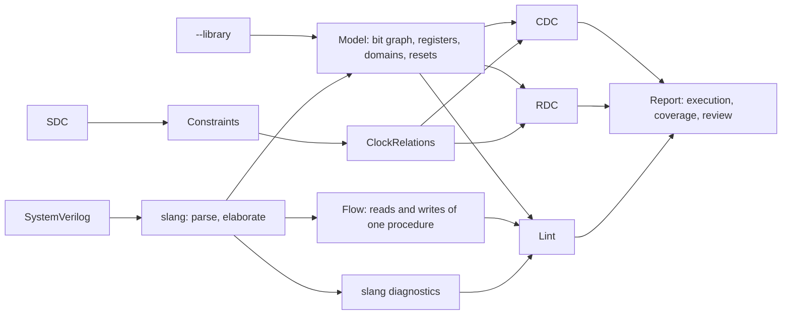
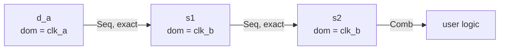
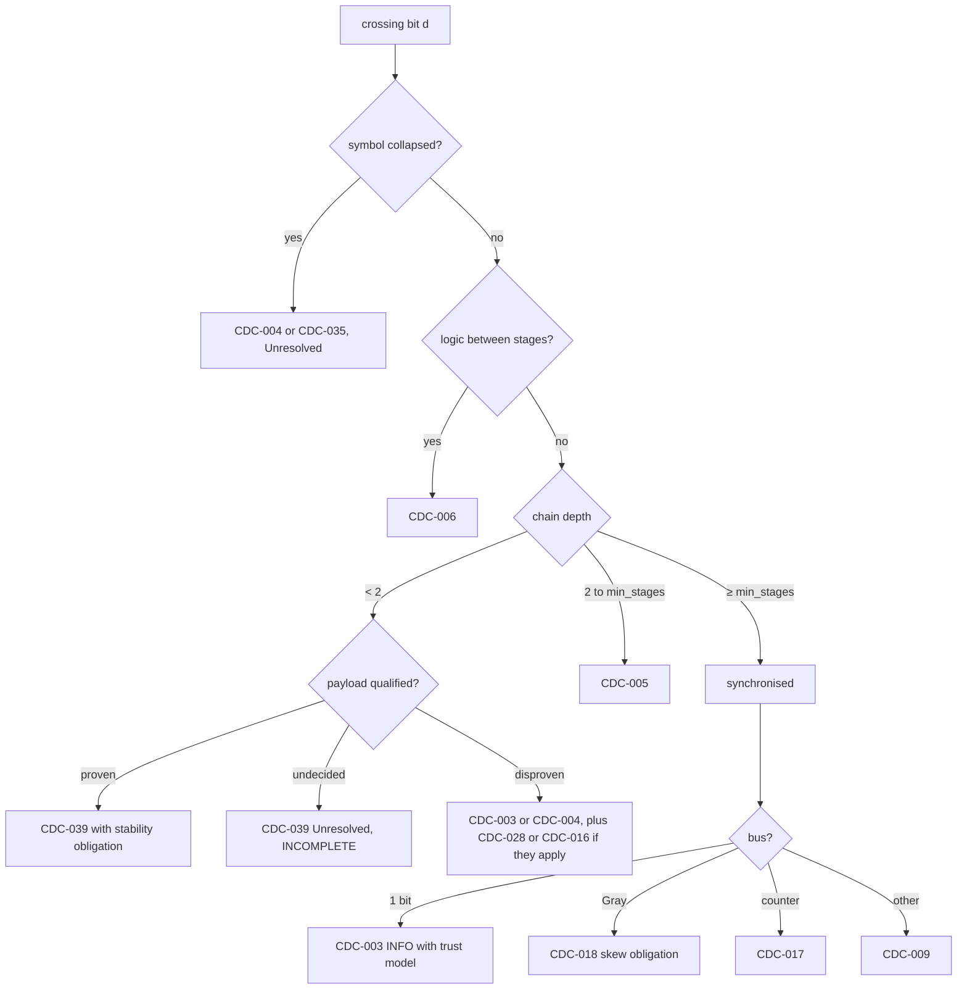
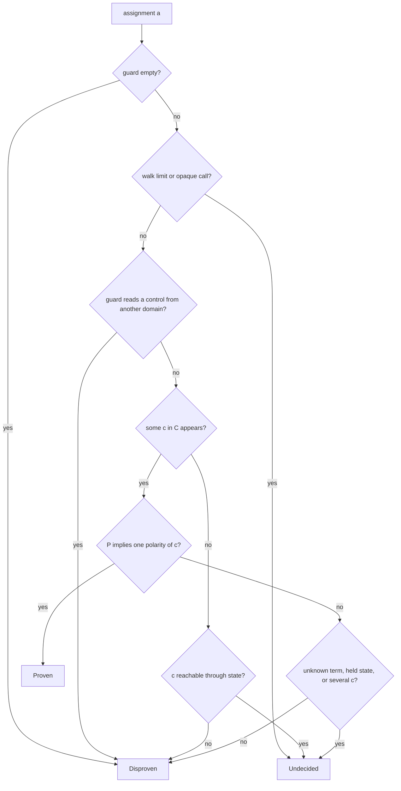
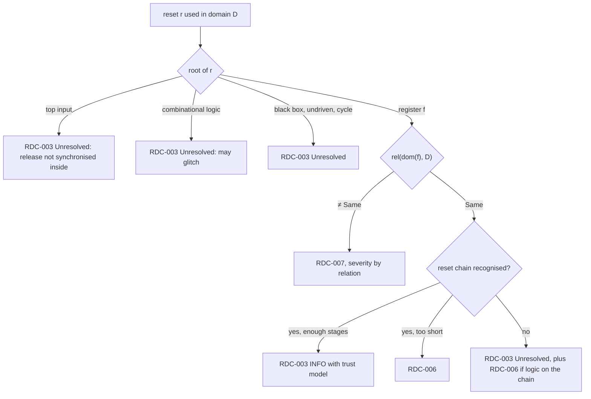

# How the analyses work

What the tool actually decides, so a result can be checked against it. Triggers and severities per rule are in the family docs; status per rule is in `catalog.json`.

**No ERROR means no established violation under the assumptions below. It does not mean the design is correct.**

Every analysis has three possible answers, and the third is never treated as the first:

```text
holds(x)     established, reported with the trust model it relies on
violated(x)  established, reported as a violation
unknown(x)   reported as Unresolved, at least WARNING, scope marked INCOMPLETE
```



## Prerequisites of every run

| The run assumes | If it does not hold | So you should |
|---|---|---|
| **One configuration.** Only the elaborated parameters are analysed; logic behind a constant-false condition is not. | Other configurations are not covered. | Run each configuration that matters (`-G`). |
| **One mode.** `set_case_analysis` selects one operating mode. | CST-014 warns that the other values are not covered; coverage stays INCOMPLETE. | Run each mode. |
| **Declared clocks.** Clock relationships come from the SDC and are trusted, not checked against intent. | Undeclared: crossings are Unresolved, never safe. Declared wrongly: a real crossing can be hidden. | Review the SDC as design input. |
| **A complete design.** Every module has source. | A module without source is a black box, Unresolved unless `--library` describes it. Library descriptions are trusted. | Supply source, or declare and review the cell. |
| **RTL only.** | MTBF, skew, routing delay, recovery/removal and timing closure cannot be shown. They stay obligations on every design. | Close them with timing tools. |

### What the SDC reader applies

The evaluator is bounded, not Tcl: its limits are in the [RFC](../SVerity_RFC.md#4-rules). A command it cannot evaluate applies nothing (it is atomic) and is disclosed by CST-009 or CST-018; dependent values are never guessed.

| Command | Effect | Not applied, disclosed instead |
|---|---|---|
| `create_clock`, `create_generated_clock`, `set_clock_groups` | Domain names and relationships | Generated relationships are assumed, not derived (CDC-030) |
| `set_input_delay` | Input contract for CDC-029 | Does not declare a clock relationship |
| `set_output_delay` | External capture clock for CST-012 | Does not prove timing |
| `set_case_analysis 0\|1` | Scalar top-level data inputs: the model is rebuilt with that constant | Internal, driven and multi-bit targets, clock and reset event sources: CST-009 with a reason. Conflicting values apply nothing. |
| `source`, `foreach`, `set`, `$var`, `all_inputs` | Bounded evaluation | Options, cycles, excessive depth |

Case analysis prunes only what it proves: logical AND/OR/NOT, scalar bitwise NOT and non-narrowing conversions, propagated through single unconditional scalar drivers to a fixed point. A call in a condition blocks pruning, even with a false conjunct. Lint still reads the elaborated source.

## The model: what we read from slang

slang gives the elaborated design. From it, one model is built per run, and every CDC, RDC and model-based lint rule reads the same one.

```text
Graph      G = (V, E)
Node       v ∈ V      one bit of one signal in one instance  (inst, sym, bit)
Edge       u → v      u influences v, with:
             type     Comb | Seq (D side of a register) | AsyncCtl (async reset/set pin)
             exact    pure bit move, no logic on the path
             ctrl     u is a condition (enable or select), not data
             op, inv  innermost operator, polarity (0, 1, unknown)

Register   f ∈ F      per bit: q, clock, domain, edge, async resets and the value each
                      forces, sync-reset candidate, blocking?, released value
Domain     dom(f)     the root of f's clock, traced back through aliases
Guards     P_a(f)     Boolean condition under which assignment a of f moves data
Relation   rel(A, B)  Same | Async | Exclusive | Unknown, from the SDC only

Cone       cone(f) =  { r ∈ F ∪ inputs | r reaches f.D through Seq, then Comb edges }
                      the walk stops at registers; it also collects black boxes,
                      undriven nets, truncated drivers and unresolved calls
```

For example, `s1 <= d_a; s2 <= s1;` clocked by `clk_b`, with `d_a` launched by `clk_a`, becomes:



```text
rel(clk_a, clk_b) = Async   ⇒   d_a → s1 is a crossing, s1 → s2 is its synchroniser
```

**Precision loss is recorded, never silent.** It becomes a model fallback (CST-010) or a leaf in the cone, and any rule that reaches it reports Unresolved:

- A signal over 16384 bits collapses to one node, so nothing bit-level can be concluded.
- A register assigned by several sequential blocks keeps only the first block's clock, so every cone reaching it is unresolved. Its only reported relationship depends on source order: CST-012 can read ERROR or Unresolved, never consistent.
- Interface ports and references are not followed as ordinary nets.
- Subroutines: arguments and nonlocal reads in the body join the cone, cached per elaborated subroutine. Recursion, ambiguous state ownership, unresolved effects or a budget stop leave an uncertain call on that cone. A side-effect write is an unresolved capture, never an exact transfer. The function's name is never evidence.
- A nested AND/OR mix on an edge is classified `other`.

**Blind spots.** Function values, procedural order inside a call, output and `ref` transfers, persistence of local or package state, and initial and final processes are outside the register model.

## CDC

### What we look for

| Problem | In plain words | Rules |
|---|---|---|
| Missing synchroniser | A register samples a signal from another clock and can go metastable. | CDC-003, 004 |
| Broken synchroniser | Too short, logic between stages, a tapped stage, mismatched clocks or resets. | CDC-005, 006, 007, 026 |
| Glitch before capture | Logic before the first stage can pulse, and the pulse can be sampled. | CDC-008 |
| Incoherent bus | Bits synchronised separately can arrive in different cycles. | CDC-009, 032 |
| Reconvergence | Separately crossed signals meet again, and their relative order is lost. | CDC-010 |
| Payload protocols | Data captured when a synchronised control says it is valid. | CDC-016, 028, 039 |
| Gray pointers and FIFOs | One bit changes per step, so a late sample is still a valid value. | CDC-017, 018, 034 |
| Toggle and handshake | Events and request/acknowledge loops between domains. | CDC-014, 015, 024 |
| Clock structure | Gates, muxes and generated clocks that can glitch or change the domain. | CDC-019, 020, 030, 031, 045 |
| Boundaries | Top-level inputs and outputs, black boxes, memories. | CDC-029, 023, 035, 046, CST-012 |

### What we read

Registers with their domains, `rel`, cones, exact and control edges, guards `P_a`, and source expressions for Gray recognition.

### How we identify it

**1. Find crossings.** For each register `d` and each source register `s` in its cone:

```text
crossing(s, d)  ⇔  dom(s) ≠ dom(d) ∧ rel(dom(s), dom(d)) ≠ Same
```

Bits are grouped by source and destination symbol, so one bus is one crossing group. The relationship sets the severity of a violation:

```text
sev(Async) = ERROR      sev(Unknown) = WARNING, Unresolved      sev(Exclusive) = INFO
```

**2. Classify each destination bit**, then report per group:



**3. Synchroniser chain.** `s1 … sn` is a chain for a crossing when:

```text
first(s1)    ⇔  no control edge into s1 except a recognised sync reset
                ∧ s1's next value does not depend on s1
                ∧ no unresolved call on its cone

next(si, t)  ⇔  dom(t) = dom(si) ∧ t and si are nonblocking
                ∧ every Seq edge into t comes from si (or its aliases), or is t's sync reset
                ∧ at least one of those edges carries data, not only an enable
                ∧ no unresolved call on t's cone

clean        ⇔  each next edge is exact,  otherwise CDC-006
                ∧ same edge and same resets per stage,  otherwise CDC-026
                ∧ non-final stages feed only the next stage,  otherwise CDC-007
```

So `if (s2) held <= 1` makes `held` a consumer, not a stage, and a "reset" driven by a later stage of the chain is feedback, not a reset.

- **Assumes:** the first stage resolves within one destination cycle, and the source is glitch-free and held long enough. This is the stated trust model, not a proof.
- **Does not show:** that logic before the first stage is safe. That is CDC-008, and such a chain can still be recognised.
- **Must stay flagged:** `CDC-003/bad_first_stage_enable`, `bad_first_stage_hold_mux`, `bad_blocking_pipeline`.

**4. Synchronous reset candidate.** A register's control edge is ignored for chain recognition only if it looks like a reset:

```text
syncReset(c, f)  ⇔  c is one named 1-bit signal, possibly negated, forcing constants on f
                    ∧ ( c is the block's first branch
                      ∨ c is a final if with no else, after one unconditional exact NBA to that bit )
```

- **Does not show:** that `c` is really a reset. This is a heuristic on form, and `c` may be X. It stays in the graph, so a guard from another domain is still a crossing.
- **Must stay flagged:** `CDC-003/bad_trailing_nonconstant`, `bad_trailing_reset_not_last`, `bad_trailing_source_guard`.

**5. Payload qualification.** For a bit with no chain, let `C` be the outputs of chains from `dom(s)` into `dom(d)`, and `P_a` the guard of each data-moving assignment `a`. Guards become Boolean formulas. Registers and unsupported terms become free atoms, so they can only weaken the proof.

```text
proven(a)    ⇔  ∃ c ∈ C:  (P_a ⇒ c)  ∨  (P_a ⇒ ¬c)            checked by enumeration
qualified    ⇔  ∀ a: proven(a)
```



The limits are 12 atoms, 256 facts and 64 reached nodes; past them the result is Undecided.

- **Does not show:** that the payload is stable while captured (it stays a WARNING), or that a FIFO's valid belongs to the slot being read.
- **Must stay flagged:** `CDC-028/bad_or_bypass_temporary`, `bad_qualifier_wrong_destination`.

**6. Gray and counters.**

```text
gray(s)     ⇔  every nonconstant write of s is  b ^ (b >> 1), with both b the same value,
                  inline, or in a single-statement function with that elaborated body
                  and matching width and signedness; or an XOR of adjacent bits of one vector
                ∧ b is counter-like
counter(S)  ⇔  some bit of S has another bit of S in its cone          (carry)
```

- **Does not show:** that the value only steps by one, or the skew between bits. Skew is the CDC-018 obligation.
- **Unknown:** a value from any other function is Unresolved, never called a counter or Gray.
- **Must stay flagged:** `CDC-017/bad_gray_of_data`, `mut_binary_pointer`, `unknown_misnamed_binary_function`; `CDC-009/bad_gray_of_different_slices`.

**7. Protocols.** Each is recognised from structure and reported with an obligation (CDC-024). None is proven.

```text
toggle(s)      ⇔  s depends on itself ∧ s is synchronised ∧ receiver XORs the chain with its delayed copy
handshake(a,b) ⇔  a and b are synchronised single bits in opposite directions
                  ∧ each one's source depends on the other's chain     one way only: CDC-015 WARNING
fifo(g1,g2)    ⇔  gray(g1) ∧ gray(g2), in opposite directions, same instance
```

**8. Reconvergence (CDC-010).** A destination cone with two or more asynchronous influences is reported: separately synchronised source bits, raw unqualified crossings, or signals that passed one pipeline register after their synchronisers. This is a structural heuristic, not a proof of glitch freedom.

**9. Subroutines.** Reads in a function body join the cone, so feedback through a function disqualifies a first stage. Dependencies alone prove neither Gray encoding, nor qualification, nor stability.

- **Must stay flagged:** `CDC-003/bad_hidden_function_read`, `bad_nested_conditional_function`, `bad_package_hierarchical_function`, `bad_hidden_function_feedback`; `CDC-004/bad_function_body_and_argument`; `CST-010/unknown_recursive_function`, `unknown_subroutine_side_effects`.

**10. Output boundary (CST-012).** For an output with a valid `set_output_delay -clock X`:

```text
∀ launch register r in the output's combinational cone:  check rel(dom(r), X)
```

Feed-through inputs, no launch register, mixed domains, opaque calls and black boxes cannot establish a contract, but a known asynchronous launch stays a violation even when the rest of the cone is unknown. A final synchroniser stage is a launch register. Outputs with no delay are not warned one by one. This does not show physical timing or the receiver's protocol.

- **Must stay flagged:** `CST-012/bad_async_launch`, `unknown_mixed_domains`, `unknown_feedthrough`, `bad_function_hidden_state`, `unknown_relationship`, `bad_upstream_synchroniser`, `unknown_opaque_call`, `unknown_blackbox`, `unknown_multiple_sequential_drivers`.

## RDC

### What we look for

| Problem | In plain words | Rules |
|---|---|---|
| Unsafe reset release | Release must be synchronous to the clock it resets, or registers leave reset in different cycles. | RDC-003, 006, 007, 016 |
| Reset built from logic | A reset from gates or other registers can glitch or race. | RDC-008, 009, 014, 017, 019 |
| Data across reset domains | The source resets while the destination runs, so the destination sees an unplanned change. | RDC-004, 005, 010 |
| Sequencing | Order of resets and release across FIFOs and handshakes. | RDC-011, 023, 024, CDC-041 |
| Inventory and limits | Sources, polarity, and what RTL cannot show. | RDC-001, 002, 012, 013, 029 |

### What we read

Per register bit: async resets and their roots, polarity by edge, the value each reset forces, the exact released value or source, plus `rel` and cones.

### How we identify it

**1. Classify each reset per receiving clock domain.**



**2. Reset synchroniser chain.** Walking `f1 … fn` back from the output, with `a` the asserted value:

```text
chain(f1…fn)  ⇔  a ∈ {0, 1} ∧ all downstream reset users agree with a
                 ∧ ∀i: fi nonblocking ∧ clock resolved ∧ same edge and domain
                 ∧ ∀i: fi has the same async reset root and polarity
                 ∧ ∀i: fi's assertion assigns exactly a, in a known two-branch transition
                 ∧ first stage releases to the constant ¬a
                 ∧ each later stage releases exactly to the previous stage
```

A known transition needs a simple reset conditional, with straight-line branches and one nonblocking write per bit in each branch. Concatenated and individual writes are the same. Nested conditions, enables, loops, timing controls, opaque calls, X or Z values do not establish it, and having no data edge does not prove a constant. Library flops use their declared reset value, polarity and data port.

- **Assumes:** nonblocking stages resolve metastability, under the same trust model as CDC. Library cells are trusted.
- **Does not show:** release order, recovery/removal, minimum pulse width, retention or isolation. These are obligations or need power intent.
- **Unknown:** an unrecognised chain is Unresolved and marks reset extraction INCOMPLETE.
- **Must stay flagged:** `RDC-003/bad_blocking_stages`, `bad_inconsistent_assertion`, `bad_asserted_release_constant`, `bad_opposite_clock_edges`, `bad_unknown_release`, `bad_high_impedance_release`, `bad_downstream_polarity`, `bad_opposite_raw_polarities`, `bad_third_stage_assertion`, `bad_data_fed_chain_is_not_a_synchroniser`; `RDC-006/bad_single_stage`; `RDC-016/bad_stage_tap`.

**3. Data across reset domains.** Let `resets(f)` be the async reset roots of `f`:

```text
mismatch(s, d)  ⇔  s ∈ cone(d) ∧ resets(s) ⊄ resets(d)
RDC-004  if dom(s) = dom(d)        RDC-005  if rel(dom(s), dom(d)) ≠ Same
```

This is a structural mismatch, not proven corruption. Even a recognised data synchroniser leaves it open: its trust model covers metastability, not whether the destination tolerates a reset-induced change. So it stays a WARNING with proof NOT_ATTEMPTED.

## Lint

### What we look for

| Problem | In plain words | Examples |
|---|---|---|
| Language and elaboration | Illegal or suspicious code the compiler can see. | LNT-001, 002, 004, 065 |
| Structure | Drivers, cycles and connectivity of the elaborated design. | LNT-012, 027, 042, 047 |
| Procedure behaviour | Latches, overwritten values, reads before writes. | LNT-013, 025, 044, 053 |
| Width and arithmetic | Values lost or changed by sizing. | LNT-035, 036, 057, 073 |
| Reset and initialisation | State with no defined start, reset branches that do not reset. | LNT-054, 067, 070 |
| Synthesizability and race | Constructs that simulate differently from hardware. | LNT-015, 019, 060, 063 |

### What we read

Lint uses the view that fits the question. Each rule has one.

| Source | Gives | Limit |
|---|---|---|
| **slang diagnostics** | Compiler warnings, mapped to rules. | Inherits slang's limits on case coverage and `continue`. |
| **AST** | Expressions, types and widths, by query. | Sees source shape, not values. |
| **Flow** | For one procedure, reads and writes in order, with reaching definitions and path guards. | Below. |
| **Model** | The bit graph above. | Fallbacks recorded in coverage. |

```text
Flow, for procedure p:
  access   read or write of a bit range, with its guards
  write    exact?  blocking?  live at the end?  used by some read?
  read     reaching writes; entryOnly: only the value from before p can be seen
  Kill(v, w)        w replaces v on some path
  exclusive(a, b)   a and b can never run in one activation
```

### How we identify it

```text
LNT-013 latch      ∃ variable with unassigned bits at the end of p               (legacy always)
LNT-025 conflict   conditional writes v before w, same kind, static ranges,
                   range(v) ⊆ range(w), ¬exclusive(v, w), values may differ
LNT-044 read       read with entryOnly ∧ a later whole write in p
LNT-053 dead       Kill(v, w), both exact, same kind, range(v) ⊆ range(w),
                   no read between, not observed, not in a loop
LNT-012 cycle      a Comb-only self-dependency, or a Comb strongly connected component
LNT-027 clock      clock root reaches a register D or an output through Comb edges
```

**Flow limits.** Flow never claims more than it walked, and a rule that depends on these reports Unresolved:

- Loops are walked once, so no overwrite claim crosses iterations.
- A user call or a mid-body timing control makes the procedure `opaque`.
- A `continue`, or a case whose items cannot all match, makes it `approximated`.
- Guards are not kept as full AND/OR trees.

**LNT-025 in detail.** Independent `if`s already give last-write priority in SystemVerilog, so an overlap of different values is a review question: Flow proves neither exclusivity nor intent. Two exemptions:

- **Equal values:** two known integral literals, equal after implicit conversions, on the same exact range, with no opaque call between. This proves that pair agrees, not that the protocol is right.
- **Text chains:** narrow, whole-target string-literal selection chains are INFO, as an assumed idiom. Every pair stays reported, and `LNT-025.priority_chains=warning` raises them. INFO here is an assumption, not a discharged obligation.

**Does not show:** intent, or the behaviour of user functions at the procedure level. The model follows function dependencies, but Flow stays opaque at the call.

## When changing an analysis

Update this page in the same commit. A new or widened recognition needs an unsafe lookalike fixture listed here first. A design with no findings still needs reading by hand before it counts as evidence.
