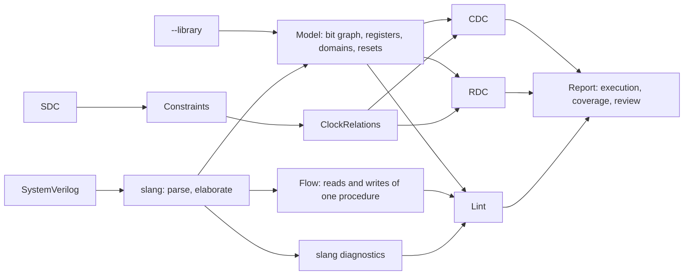
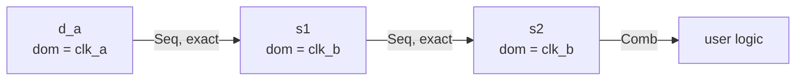
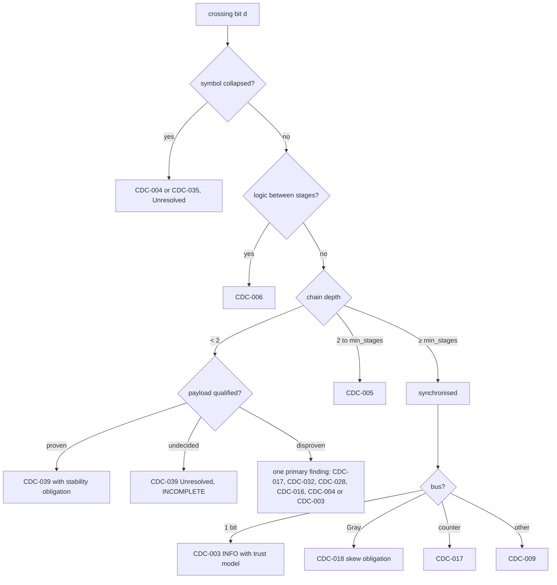
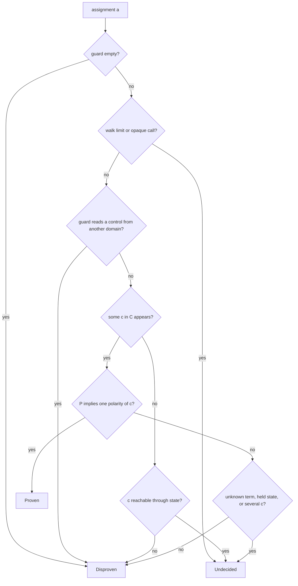
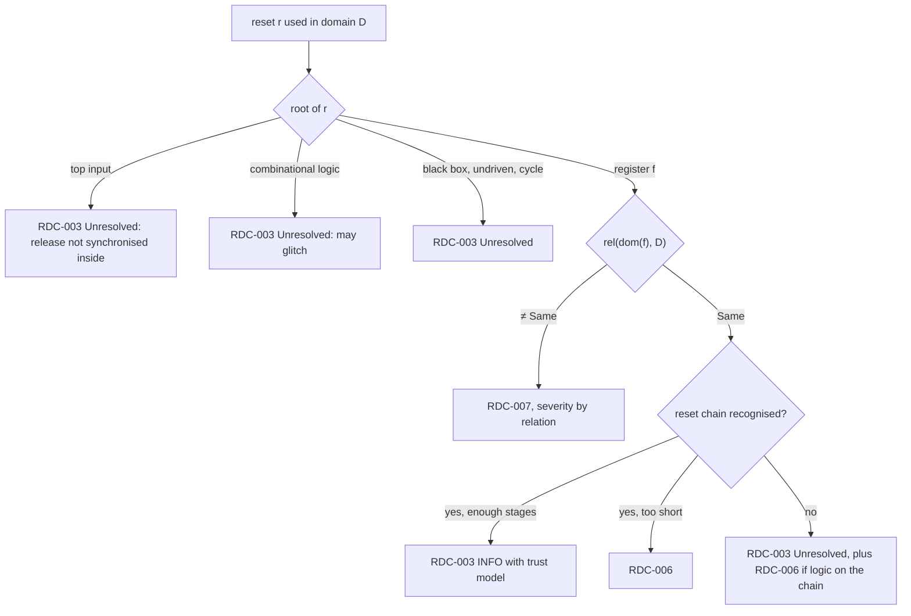

# How the analyses work

What the tool actually decides, so a result can be checked against it. Triggers and severities per rule are in the family docs; status per rule is in `catalog.json`.

**No ERROR means no established violation under the assumptions below. It does not mean the design is correct.**

Every analysis has three possible answers, and the third is never treated as the first:

```text
holds(x)     established, reported with the trust model it relies on
violated(x)  established, reported as a violation
unknown(x)   reported as Unresolved, at least WARNING, scope marked INCOMPLETE
```



## Prerequisites of every run

| The run assumes | If it does not hold | So you should |
|---|---|---|
| **One configuration.** Only the elaborated parameters are analysed; logic behind a constant-false condition is not. | Other configurations are not covered. | Run each configuration that matters (`-G`). |
| **One mode.** `set_case_analysis` selects one operating mode. | CST-014 warns that the other values are not covered; coverage stays INCOMPLETE. | Run each mode. |
| **Declared clocks.** Clock relationships come from the SDC and are trusted, not checked against intent. | Undeclared: crossings are Unresolved, never safe. Declared wrongly: a real crossing can be hidden. | Review the SDC as design input. |
| **A complete design.** Every module has source. | A module without source is a black box, Unresolved unless `--library` describes it. Library descriptions are trusted. | Supply source, or declare and review the cell. |
| **RTL only.** | MTBF, skew, routing delay, recovery/removal and timing closure cannot be shown. They stay obligations on every design. | Close them with timing tools. |

### What the SDC reader applies

The evaluator is bounded, not Tcl: its limits are in the [RFC](../SVerity_RFC.md#4-rules). A command it cannot evaluate applies nothing (it is atomic) and is disclosed by CST-009 or CST-018; dependent values are never guessed.

| Command | Effect | Not applied, disclosed instead |
|---|---|---|
| `create_clock`, `create_generated_clock`, `set_clock_groups` | Domain names and relationships | Generated relationships are assumed, not derived (CDC-030) |
| `set_input_delay` | Input contract for CDC-029 | Does not declare a clock relationship |
| `set_output_delay` | External capture clock for CST-012, with `-min`, `-max` and `-add_delay` (each contract on a port is checked) | Does not prove timing; `-rise`, `-fall`, `-clock_fall` and `-reference_pin` limit or move a contract and are not applied |
| `set_case_analysis 0\|1` | Top-level data inputs, scalar or named bits of a vector declared `[N:0]` (`mode[0]`, `mode[*]`): the model is rebuilt with those constants. A bit nothing fixes stays unknown, so `mode == 2'b01` is decided only when a fixed bit differs or every bit is fixed. An undriven internal object takes the value as a stated assumption (CST-014 says so, and its lint finding stays). A driven one is accepted only when its one driver already proves the value, counting a child output as a driver, because overriding a driver would let a mistaken constraint delete the defect being checked; a contradiction is not applied. Any procedural write, a force, a declaration initialiser, a primitive and a net alias rule a value out, whatever form the write takes, such as `{<<{m}} = 1`, `m++` or a `ref` argument. Only the written root of a target counts: an index (`v[m] <= x`), an input argument and a displayed value (`$display(m)`) are reads and leave `m` free to take a value. Selections, concatenations, equality and reductions are evaluated; other logic and `case` statements keep every branch, which can only add findings. | Unapplied, CST-009 with a reason: a whole-vector name (tools differ on what it means), other declared ranges, structs, a driven target whose single continuous driver does not prove the same value, one with several or unresolved drivers, an object the model does not see written (see the order below), a register output, an undriven object in a module with shared symbols, and clock and reset event sources. Conflicting values apply nothing. |
| `source`, `foreach`, `if`/`elseif`/`else`, `set`, `$var`, `all_inputs`, `all_inputs -no_clocks` | Bounded evaluation; conditional branches require a decidable `expr` condition. `-no_clocks` leaves out ports and port bits declared as clocks anywhere in the constraint set, whatever the order, so a clock declared later only removes a contract; a clock nothing declares stays in. | Unsupported options, cycles, excessive depth, undecidable reached conditions |

Clock declaration history is retained for diagnostics, while the latest same-name definition owns its targets in domain naming. `-add` suppresses the override warning; multiple clock names on one target still map to one domain name (the first matching active declaration), so alternative clock modes are not enumerated. Generated source objects and explicit master names are retained separately. Their declared ancestry is checked against clock groups, including transitive ancestors; it never proves RTL derivation or synchrony. Clock groups take precedence: the first separating group supplies Async or Exclusive even for an invalid generated master; with no separating group, distinct names remain Unknown.

Case analysis prunes only what it proves: logical AND/OR/NOT, scalar bitwise NOT, non-narrowing conversions, selects, concatenations, equality and reductions, propagated through single unconditional scalar drivers to a fixed point. A call in a condition blocks pruning, even with a false conjunct. Lint still reads the elaborated source.

**A case value is an assumption, not evidence.** It can remove findings, so a mistaken one must not delete the defect being checked. Each target therefore takes the first answer that applies:

```text
conflicting values              → nothing applied, CST-018
struct or interface member      → not applied      not followed as a plain signal
offset ≠ declared index         → not applied      [0:1] has mode[0] as its top bit
reset or clock source           → not applied      no state for "stopped" or "held" exists
register output                 → not applied      nothing shows it holds over time
written procedurally in any form → not applied      also forced, initialised, or tied to a primitive
                                                   or alias: a case value only stands in for no driver,
                                                   or agrees with one continuous driver
no driver, one instance         → applied, stated as an assumption (the lint finding stays)
no driver, shared symbol        → not applied      one value would reach the other instances
more than one driver            → not applied      counting a child's output or inout
one driver proving the value    → applied
one driver proving the opposite → not applied, a contradiction
one driver, value not proved    → not applied      overriding it is not implemented
```

A declaration is atomic, and a proof may use only declarations that were themselves applied, so they are retried until nothing changes.

A bit nothing fixes stays unknown, and the evaluator has three bit values rather than two:

| Expression, with `mode[1]=1` and `mode[0]` unfixed | Decided as | Why |
|---|---|---|
| `if (mode)` | true | one known 1 makes the value non-zero |
| `&mode` | unknown | the unfixed bit decides it |
| `\|mode` | 1 | one known 1 decides it |
| `mode == 2'b01` | false | the top bit already differs |
| `mode == 2'b11` | unknown | the other bit could still differ |
| `q <= {mode[1], data}` | keeps `data` | true as a condition, yet the other bit still carries the crossing |

The last row is the trap in this evaluator: being non-zero fixes a condition, not a value. Only a one-bit value drops its reads outright.

Unsafe designs these rules keep flagging: a child output that holds a wired-OR at 1 while `en=0` suggests 0 (`unknown_second_driver_in_child`), `initial force m = 1` (`unknown_forced_net`), `logic m = 1` (`unknown_declaration_initialiser`), a task called from `initial` (`unknown_write_in_called_task`), `buf(m, en)` (`unknown_primitive_driver`), `wire m = 1'b1` with a request for 0 (`unknown_driven_contradicts_driver`), a value on `u0` that must leave sibling `u1` alone (`boundary_sibling_instance`).

Why a clock or reset source stays out: a stopped clock does not make its registers constant, because an asynchronous reset can still change them. A released reset does not say what the registers start from. An asserted one is a statement about initialisation. One net can also reset different registers at opposite polarity, so its value is not a global "reset off". This needs retained state and per-register reset state in the model, and pruning `if (!rn)` alone would leave the event list and the reset metadata disagreeing.

## The model: what we read from slang

slang gives the elaborated design. From it, one model is built per run, and every CDC, RDC and model-based lint rule reads the same one.

```text
Graph      G = (V, E)
Node       v ∈ V      one bit of one signal in one instance  (inst, sym, bit)
Edge       u → v      u influences v, with:
             type     Comb | Seq (D side of a register) | AsyncCtl (async reset/set pin)
             exact    pure bit move, no logic on the path
             ctrl     u is a condition (enable or select), not data
             op, inv  innermost operator, polarity (0, 1, unknown)

Register   f ∈ F      per bit: q, clock, domain, edge, async resets and the value each
                      forces, sync-reset candidate, blocking?, released value
Domain     dom(f)     the root of f's clock, traced back through aliases
Guards     P_a(f)     Boolean condition under which assignment a of f moves data
Relation   rel(A, B)  Same | Async | Exclusive | Unknown, from the SDC only

Cone       cone(f) =  { r ∈ F ∪ inputs | r reaches f.D through Seq, then Comb edges }
                      the walk stops at registers; it also collects black boxes,
                      nets with no driver (a constant is a driver, a loop index is not a signal),
                      truncated drivers and unresolved calls
```

For example, `s1 <= d_a; s2 <= s1;` clocked by `clk_b`, with `d_a` launched by `clk_a`, becomes:



```text
rel(clk_a, clk_b) = Async   ⇒   d_a → s1 is a crossing, s1 → s2 is its synchroniser
```

A hub stands in for a large all-to-all assignment: `sources -> hub -> targets` states the same dependencies with fewer edges. A signal can be both data and enable of one target, and those stay separate edges, because `if (s) t <= s` holds `t` when `s` is low and so is no synchroniser stage.

**Why bit precision matters twice.** Treating `a & b` as "every bit of `a` and `b` reaches every bit of the result" looks only imprecise, but on OpenTitan AES it invented a dependency that produced a false ERROR, and it accounted for most of the 4.59 million edges. Keeping bits apart where the operator does removed the ERROR and took the graph to 454,185 edges and the run from 118 s to 4.6 s. Wrong edges cost accuracy and time together, so look for one cause before treating them as separate problems.

The same mistake showed up in struct patterns. OpenTitan's `tlul_adapter_sram` builds its response with `'{d_valid: ..., a_ready: ...}`, and treating that as one expression made `a_ready` depend on `d_valid`. That closed an invented combinational loop (a false Established LNT-012 ERROR on `otp_ctrl` and `spi_host`) and a false path from FIFO storage to its `full_q` (two RDC-010 warnings each). The same design written field by field had neither. A pattern's elements come most significant first and already resolved, so written order and `default:` need no separate handling: `'{r: b, d: x}` stays free of a loop, and a real one through `'{d: x, r: s.d}` or `'{default: x}` is still reported.

**Repeated edges are merged, not picked from.** One signal can reach one target several times in one procedure with different attributes. `if (reinit) q <= 0; else if (wr_en) q <= d;` makes `reinit` guard `q` on both branches. Compaction keeps one edge per source, target, type, procedure and role, and the survivor says what the repeats share: differing polarity becomes unknown, differing branch becomes none, differing operator becomes other, `approximate` is kept if any repeat has it, and `internalRead` only if all do. Keeping the first repeat instead made the result depend on input order (see [Determinism](#determinism)).

**Precision loss is recorded, never silent.** It becomes a model fallback (CST-010) or a leaf in the cone, and any rule that reaches it reports Unresolved:

- A signal over 16384 bits collapses to one node, so nothing bit-level can be concluded.
- A register assigned by several sequential blocks keeps every block's clock. Each relationship takes the least safe of them, so the verdict does not depend on source order. Which block's value the register holds is not modelled, so every cone reaching it stays unresolved.
- Interface ports and references are not followed as ordinary nets.
- Subroutines: arguments and nonlocal reads in the body join the cone, cached per elaborated subroutine. Automatic locals hold nothing between calls, so they add nothing, provided `Flow` shows each is assigned before every read. Recursion, static locals, a local that can be read unassigned, ambiguous state ownership, unresolved effects or a budget stop leave an uncertain call on that cone. A side-effect write is an unresolved capture, never an exact transfer. The function's name is never evidence.
- A nested AND/OR mix on an edge is classified `other`.
- **Bits stay apart only where the operator keeps them apart:** exact moves, `~`, `&`, `|`, `^`, `^~` of equal widths, concatenation, assignment patterns that fill a packed value (`'{d: x, r: b}`, `'{x, b}`, `'{0: x, 1: b}`), conversions (a signed extension copies the top bit) and the data arms of `?:`. Everything else, including arithmetic, shifts, reductions and a `?:` select, is a leaf whose reads reach all its bits. Removing an edge here must be justified by the operator, because a missing edge is a missed crossing.

**Blind spots.** Function values, procedural order inside a call, output and `ref` transfers, persistence of local or package state, and initial and final processes are outside the register model.

## CDC

### What we look for

| Problem | In plain words | Rules |
|---|---|---|
| Missing synchroniser | A register samples a signal from another clock and can go metastable. | CDC-003, 004 |
| Broken synchroniser | Too short, logic between stages, a tapped stage, mismatched clocks or resets. | CDC-005, 006, 007, 026 |
| Glitch before capture | Logic before the first stage can pulse, and the pulse can be sampled. | CDC-008 |
| Incoherent bus | Bits synchronised separately can arrive in different cycles. | CDC-009, 032 |
| Reconvergence | Separately crossed signals meet again, and their relative order is lost. | CDC-010 |
| Payload protocols | Data captured when a synchronised control says it is valid. | CDC-016, 028, 039 |
| Gray pointers and FIFOs | One bit changes per step, so a late sample is still a valid value. | CDC-017, 018, 034 |
| Toggle and handshake | Events and request/acknowledge loops between domains. | CDC-014, 015, 024 |
| Clock structure | Gates, muxes and generated clocks that can glitch or change the domain. | CDC-019, 020, 030, 031, 045 |
| Boundaries | Top-level inputs and outputs, black boxes, memories. | CDC-029, 023, 035, 046, CST-012 |

### What we read

Registers with their domains, `rel`, cones, exact and control edges, guards `P_a`, and source expressions for Gray recognition.

### How we identify it

**1. Find crossings.** For each register `d` and each source register `s` in its cone:

```text
crossing(s, d)  ⇔  dom(s) ≠ dom(d) ∧ rel(dom(s), dom(d)) ≠ Same
```

Bits are grouped by source and destination symbol, so one bus is one crossing group. The relationship sets the severity of a violation:

```text
sev(Async) = ERROR      sev(Unknown) = WARNING, Unresolved      sev(Exclusive) = INFO
```

**2. Classify each destination bit**, then report per group:



**3. Synchroniser chain.** `s1 … sn` is a chain for a crossing when:

```text
first(s1)    ⇔  no control edge into s1 except a recognised sync reset
                ∧ s1's next value does not depend on s1
                ∧ no unresolved call on its cone

next(si, t)  ⇔  dom(t) = dom(si) ∧ t and si are nonblocking
                ∧ every Seq edge into t comes from si (or its aliases), or is t's sync reset
                ∧ at least one of those edges carries data, not only an enable
                ∧ no unresolved call on t's cone

clean        ⇔  each next edge is exact,  otherwise CDC-006
                ∧ same edge and same resets per stage,  otherwise CDC-026
                ∧ stages short of min_stages feed only the next one,  otherwise CDC-007
```

So `if (s2) held <= 1` makes `held` a consumer, not a stage, and a "reset" driven by a later stage of the chain is feedback, not a reset. CDC-006 and CDC-007 are separate findings on one crossing only when both defects exist, because they have different fixes.

**Where a chain ends is the hard part.** Finding the start is easy; the walk has to decide what counts as the next stage, and whether anything else may read a stage. Four shapes, all after `s1 <= a_q; s2 <= s1;`, with `min_stages` at its default of two:

| What follows | Reading | Result |
|---|---|---|
| `consumer <= ~s2;` | Logic after two clean stages: a consumer | Recognised 2-stage chain |
| `s3 <= s2; tap = ~s2;` | `s2` has reached the required depth, so it is already an output, and `s3` is a pipeline register or a third stage | Recognised, no CDC-007. At `min_stages=3` it is 3 stages with a tap, CDC-007 |
| `tap = ~s1;` | Read before the required depth | CDC-007 |
| `s2 <= ~s1;` instead | Logic before the chain has two stages | CDC-006 |

An exact continuation is the next stage wherever it comes in the source, so swapping independent assignments changes nothing. The stage that reaches the required depth is the synchroniser's output, and so is every follower, for qualifier and reconvergence checks too, so an unused follower changes no result. Checks that compare the synchroniser with its source (CDC-041) use that output stage, never a follower. A chain short of the required depth has no output: its last stage stands in, marked short, so CDC-005 reports the chain and a payload it qualifies stays Undecided (CDC-039). Clock edge and reset agreement (CDC-026) are required only of the stages up to that depth.

The second row used to report CDC-007 for any register that had a follower, asking "is this the last register?" rather than "has it been through the required depth?". OpenTitan's `prim_diff_decode` and `uart` show why that is wrong: each follows a clean `prim_flop_2sync` with a pipeline register for edge detection or majority voting and also reads the output directly, and both are correct.

With `min_stages` above two, the first row stops at two stages and reports CDC-005, not CDC-006.

The first row used to be read as a broken third stage. That is what the roadmap's "duplicated broken-chain finding" turned out to be: on OpenTitan `clkmgr`, 8 clean `prim_flop_2sync` crossings each got a false CDC-006 and a false CDC-007, because a capture of the real last stage in another domain then looked like a leak from a middle stage. The public gate designs never showed it.

- **Assumes:** the first stage resolves within one destination cycle, and the source is glitch-free and held long enough. This is the stated trust model, not a proof.
- **Does not show:** that logic before the first stage is safe. That is CDC-008, and such a chain can still be recognised.
- **Must stay flagged** (as CDC-028 with CDC-003 as evidence): `CDC-003/bad_first_stage_enable`, `bad_first_stage_hold_mux`, `bad_blocking_pipeline`, `CDC-028/bad_stage_enabled_by_its_own_data`.

**4. Synchronous reset candidate.** A register's control edge is ignored for chain recognition only if it looks like a reset:

```text
syncReset(c, f)  ⇔  c is one named 1-bit signal, possibly negated, forcing constants on f
                    ∧ ( c is the block's first branch
                      ∨ c is a final if with no else, after one unconditional exact NBA to that bit )
```

- **Does not show:** that `c` is really a reset. This is a heuristic on form, and `c` may be X. It stays in the graph, so a guard from another domain is still a crossing.
- **Must stay flagged:** `CDC-003/bad_trailing_nonconstant`, `bad_trailing_reset_not_last`, `bad_trailing_source_guard`.

**5. Payload qualification.** For a bit with no chain, let `C` be the outputs of chains from `dom(s)` into `dom(d)`, and `P_a` the guard of each data-moving assignment `a`. Guards become Boolean formulas. Registers and unsupported terms become free atoms, so they can only weaken the proof.

```text
proven(a)    ⇔  ∃ c ∈ C:  (P_a ⇒ c)  ∨  (P_a ⇒ ¬c)            checked by enumeration
qualified    ⇔  ∀ a: proven(a)
```

A proof that leans on a chain short of the required depth is Undecided, not proven: that qualifier may itself be metastable when it opens the capture.



The limits are 12 atoms, 256 facts and 64 reached nodes; past them the result is Undecided.

- **Does not show:** that the payload is stable while captured (it stays a WARNING), or that a FIFO's valid belongs to the slot being read.
- **Must stay flagged:** `CDC-028/bad_or_bypass_temporary`, `bad_qualifier_wrong_destination`.

**6. Gray and counters.**

```text
gray(s)     ⇔  every nonconstant write of s is  b ^ (b >> 1), with both b the same value,
                  inline, or in a single-statement function with that elaborated body
                  and matching width and signedness; or an XOR of adjacent bits of one vector
                ∧ b is counter-like
counter(S)  ⇔  some bit of S has another bit of S in its cone          (carry)
```

- **Does not show:** that the value only steps by one, or the skew between bits. Skew is the CDC-018 obligation.
- **Unknown:** a value from any other function is Unresolved, never called a counter or Gray.
- **Must stay flagged:** `CDC-017/bad_gray_of_data`, `mut_binary_pointer`, `unknown_misnamed_binary_function`; `CDC-009/bad_gray_of_different_slices`.

**7. Protocols.** Each is recognised from structure and reported with an obligation (CDC-024). None is proven.

```text
toggle(s)      ⇔  s depends on itself ∧ s is synchronised ∧ receiver XORs the chain with its delayed copy
handshake(a,b) ⇔  a and b are synchronised single bits in opposite directions
                  ∧ each one's source depends on the other's chain     one way only: CDC-015 WARNING
fifo(g1,g2)    ⇔  gray(g1) ∧ gray(g2), in opposite directions, same instance
```

**Same launch bit, several chains (CDC-047).** A launch bit with chains into two or more destination symbols of one domain is reported: the copies can differ for a cycle. This is the structure, not proof that logic combines them.

**8. Reconvergence (CDC-010).** A destination cone with two or more asynchronous influences is reported: separately synchronised source bits, raw unqualified crossings, or signals that passed one pipeline register after their synchronisers. This is a structural heuristic, not a proof of glitch freedom.

**9. Subroutines.** Reads in a function body join the cone, so feedback through a function disqualifies a first stage. Dependencies alone prove neither Gray encoding, nor qualification, nor stability.

- **Must stay flagged:** `CDC-003/bad_hidden_function_read`, `bad_nested_conditional_function`, `bad_package_hierarchical_function`, `bad_hidden_function_feedback`; `CDC-004/bad_function_body_and_argument`; `CST-010/unknown_recursive_function`, `unknown_subroutine_side_effects`.

**10. Output boundary (CST-012).** For an output with a valid `set_output_delay -clock X`:

```text
∀ launch register r in the output's combinational cone:  check rel(dom(r), X)
```

Feed-through inputs, no launch register, mixed domains, opaque calls and black boxes cannot establish a contract, but a known asynchronous launch stays a violation even when the rest of the cone is unknown. A final synchroniser stage is a launch register. Outputs with no delay are not warned one by one. This does not show physical timing or the receiver's protocol.

- **Must stay flagged:** `CST-012/bad_async_launch`, `unknown_mixed_domains`, `unknown_feedthrough`, `bad_function_hidden_state`, `unknown_relationship`, `bad_upstream_synchroniser`, `unknown_opaque_call`, `unknown_blackbox`, `unknown_multiple_sequential_drivers`.

## RDC

### What we look for

| Problem | In plain words | Rules |
|---|---|---|
| Unsafe reset release | Release must be synchronous to the clock it resets, or registers leave reset in different cycles. | RDC-003, 006, 007, 016 |
| Reset built from logic | A reset from gates or other registers can glitch or race. | RDC-008, 009, 014, 017, 019 |
| Data across reset domains | The source resets while the destination runs, so the destination sees an unplanned change. | RDC-004, 005, 010 |
| Sequencing | Order of resets and release across FIFOs and handshakes. | RDC-011, 023, 024, CDC-041 |
| Inventory and limits | Sources, polarity, and what RTL cannot show. | RDC-001, 002, 012, 013, 029 |

### What we read

Per register bit: async resets and their roots, polarity by edge, the value each reset forces, the exact released value or source, plus `rel` and cones.

### How we identify it

**1. Classify each reset per receiving clock domain.**



**2. Reset synchroniser chain.** Walking `f1 … fn` back from the output, with `a` the asserted value:

```text
chain(f1…fn)  ⇔  a ∈ {0, 1} ∧ all downstream reset users agree with a
                 ∧ ∀i: fi nonblocking ∧ clock resolved ∧ same edge and domain
                 ∧ ∀i: fi has the same async reset root and polarity
                 ∧ ∀i: fi's assertion assigns exactly a, in a known two-branch transition
                 ∧ first stage releases to the constant ¬a
                 ∧ each later stage releases exactly to the previous stage
```

A known transition needs a simple reset conditional, with straight-line branches and one nonblocking write per bit in each branch. Concatenated and individual writes are the same. Nested conditions, enables, loops, timing controls, opaque calls, X or Z values do not establish it, and having no data edge does not prove a constant. Library flops use their declared reset value, polarity and data port.

- **Assumes:** nonblocking stages resolve metastability, under the same trust model as CDC. Library cells are trusted.
- **Does not show:** release order, recovery/removal, minimum pulse width, retention or isolation. These are obligations or need power intent.
- **Unknown:** an unrecognised chain is Unresolved and marks reset extraction INCOMPLETE.
- **Must stay flagged:** `RDC-003/bad_blocking_stages`, `bad_inconsistent_assertion`, `bad_asserted_release_constant`, `bad_opposite_clock_edges`, `bad_unknown_release`, `bad_high_impedance_release`, `bad_downstream_polarity`, `bad_opposite_raw_polarities`, `bad_third_stage_assertion`, `bad_data_fed_chain_is_not_a_synchroniser`; `RDC-006/bad_single_stage`; `RDC-016/bad_stage_tap`.

**3. Data across reset domains.** Let `resets(f)` be the async reset roots of `f`:

```text
mismatch(s, d)  ⇔  s ∈ cone(d) ∧ resets(s) ⊄ resets(d)
RDC-004  if dom(s) = dom(d)        RDC-005  if rel(dom(s), dom(d)) ≠ Same
```

One finding per destination register and pair of reset sets; each source is listed as evidence, because a foreign reset feeding a whole bus is one cause. This is a structural mismatch, not proven corruption. Even a recognised data synchroniser leaves it open: its trust model covers metastability, not whether the destination tolerates a reset-induced change. So it stays a WARNING with proof NOT_ATTEMPTED.

## Lint

### What we look for

| Problem | In plain words | Examples |
|---|---|---|
| Language and elaboration | Illegal or suspicious code the compiler can see. | LNT-001, 002, 004, 065 |
| Structure | Drivers, cycles and connectivity of the elaborated design. | LNT-012, 027, 042, 047 |
| Procedure behaviour | Latches, overwritten values, reads before writes. | LNT-013, 025, 044, 053 |
| Width and arithmetic | Values lost or changed by sizing. | LNT-035, 036, 057, 073 |
| Reset and initialisation | State with no defined start, reset branches that do not reset. | LNT-054, 067, 070 |
| Synthesizability and race | Constructs that simulate differently from hardware. | LNT-015, 019, 060, 063 |

### What we read

Lint uses the view that fits the question. Each rule has one.

| Source | Gives | Limit |
|---|---|---|
| **slang diagnostics** | Compiler warnings, mapped to rules. | Inherits slang's limits on case coverage and `continue`. |
| **AST** | Expressions, types and widths, by query. | Sees source shape, not values. |
| **Flow** | For one procedure, reads and writes in order, with reaching definitions and path guards. | Below. |
| **Model** | The bit graph above. | Fallbacks recorded in coverage. |

```text
Flow, for procedure p:
  access   read or write of a bit range, with its guards
  write    exact?  blocking?  live at the end?  used by some read?
  read     reaching writes; entryOnly: only the value from before p can be seen
  Kill(v, w)        w replaces v on some path
  exclusive(a, b)   a and b can never run in one activation
```

### How we identify it

```text
LNT-013 latch      ∃ variable with unassigned bits at the end of p               (legacy always)
LNT-025 conflict   conditional writes v before w, same kind, static ranges,
                   range(v) ⊆ range(w), ¬exclusive(v, w), values may differ
LNT-044 read       read with entryOnly ∧ a later whole write in p
LNT-053 dead       Kill(v, w), both exact, same kind, range(v) ⊆ range(w),
                   no read between, not observed, not in a loop
LNT-012 cycle      a Comb-only self-dependency, or a Comb strongly connected component, where a bit its
                   procedure reads only after writing has a separate node for that internal value
LNT-027 clock      clock root reaches a register D or an output through Comb edges
```

**Flow limits.** Flow never claims more than it walked, and a rule that depends on these reports Unresolved:

- Loops are walked once, so no overwrite claim crosses iterations.
- A user call or a mid-body timing control makes the procedure `opaque`.
- A `continue`, or a case whose items cannot all match, makes it `approximated`.
- Guards are not kept as full AND/OR trees.

**LNT-012 and statement order.** A procedure's own reads of a bit it always writes first are not feedback, so those reads use a second node fed by the procedure's writes. A cycle made only of second nodes is one activation's statement order: no finding. Any cycle that touches a real bit stays, so a loop that leaves the procedure still closes. This relies on a loop back edge carrying only values written inside the procedure: walking a loop once cannot hide a read of the entry value.

- **Must stay flagged:** `LNT-012/bad_read_before_first_write`, `bad_conditional_first_write`, `unknown_call_keeps_warning`, `bad_loop_through_ordered_read`.

**LNT-012 and approximate edges.** An assignment with a computed index or a user call reaches every bit in the model, which may be far more than is real. So a loop that needs such an edge is Unresolved, and a loop that remains without them stays an ERROR. Port connections alone are one net seen from two sides, not a loop, and a constant selector reads nothing, even if it names a signal inside `$bits`.

- **Must stay flagged:** `LNT-012/unknown_cycle_through_computed_index`, `unknown_cycle_through_function_argument`, `bad_precise_loop_beside_a_call`, `bad_cycle_without_computed_index`, `bad_selector_read_is_a_real_dependency`.

**LNT-025 in detail.** Independent `if`s already give last-write priority in SystemVerilog, so an overlap of different values is a review question: Flow proves neither exclusivity nor intent. Two exemptions:

- **Equal values:** two known integral literals, equal after implicit conversions, on the same exact range, with no opaque call between. This proves that pair agrees, not that the protocol is right.
- **Text chains:** narrow, whole-target string-literal selection chains are INFO, as an assumed idiom. Every pair stays reported, and `LNT-025.priority_chains=warning` raises them. INFO here is an assumption, not a discharged obligation.

**Does not show:** intent, or the behaviour of user functions at the procedure level. The model follows function dependencies, but Flow stays opaque at the call.

## Determinism

One input gives one report, because a fingerprint is what a waiver is attached to. A finding whose identity varies between runs can silently lose its waiver.

Compare a binary with itself before trusting any other comparison. Doing that on OpenTitan IPs found two causes:

- **Order-dependent merging.** See [repeated edges](#the-model-what-we-read-from-slang). The polarity of `reinit` in a crossing's identity flipped between runs, so its fingerprint did too (one run in six on `clkmgr`).
- **A thread pool.** slang's analysis named whichever instance finished first in a finding it coalesces across identical instances. Parsing still uses threads, because its result does not depend on their order; analysis does not.

The general rule: any "first one found" over an unordered input is a bug waiting for a different input order. Anything iterating over pointers or hash tables must merge or sort before the result can reach a report.

## Cost on a large design

Numbers are from `top_earlgrey` at the pinned commit with no SDC, the worst case for crossings: 3.27 million nodes, 15.5 million edges, 237,159 register bits and 76 clock domains whose relationships are all unknown. The results table is in the [roadmap](../ROADMAP.md#2-mid-term-reaching-10).

### Where the cost comes from

Crossing analysis visits every source of every register's cone, so its work is the sum of cone sizes, not the number of registers. By 112,000 of those register bits the sum was already 650 million sources. Everything inside that loop runs hundreds of millions of times, so operations that look cheap are not.

### How the model stays small

| Technique | Problem it solves | Why it is safe |
|---|---|---|
| 16-byte packed edge, adjacency in one block | Pointer-rich graphs at tens of millions of edges | Storage only |
| Hub node when sources × targets exceeds 1,024 | `n × m` edges for one assignment become `n + m` | Same dependencies; a hub has no symbol, so it matches no design object. It is only correct where every source really reaches every target |
| Hub for a read set of 32 or more bits shared by many targets | Many targets repeating one large read | As above |
| Periodic edge compaction during the build | Duplicates growing before the build ends | Repeats are merged (see above) |
| Bitwise precision | Invented dependencies | Only the operator may remove an edge: a missing edge is a missed defect |

### How cones are computed once

A cone is computed the first time it is needed, kept for all rule families, and stored once when another bit has the same sources: many bits of one bus share a cone. Two caches with two budgets:

| Cache | Budget | Holds |
|---|---|---|
| Register cones | 2^29 entries, about 2 GB | One cone per distinct source set |
| Hub cones | 2^27 entries, about 512 MB | The sources behind one hub |

They have separate budgets because their misses cost very different amounts. One budget went wrong like this:

| Registers done | Elapsed | Cone entries stored | Hubs computed |
|---:|---:|---:|---:|
| 96,000 | 49 s | 414 M | 2,241 |
| 100,000 | 53 s | 465 M | 2,289 |
| 108,000 | 105 s | 537 M (budget reached) | 2,610 |
| 112,000 | 213 s | 693 M | 9,217 |

One block, probably a memory, added 4,000 distinct cones of about 16,700 sources per 4,000 bits and filled the budget. Hubs then stopped being stored, and each was recomputed for every register behind it: 108 s for 4,000 registers, after 53 s for the first 100,000. Past a budget the answer is unchanged, only slower, so this showed up as a timeout and never as a wrong result. **Cache what is most expensive to miss, and watch for a cliff rather than a slope.**

Register cones past their budget are still recomputed each time they are needed. The budgets count entries only, and the CDC pass uses far more memory than they allow for, so they do not yet bound a run: `top_earlgrey` still runs out of memory in this pass. Storing a cone as references to hub cones instead of a flat copy might help with both, but that has not been tried.

A walk must not recurse through hubs. The first version did, and revisited shared hubs on combinational cycles exponentially, which looked like a slow run rather than a defect. The walk is now flat, with one visited set.

### Small costs that are not small

- **Names.** The crossing loop built two hierarchical names per source to find its group, about a third of the sampled time. A name is now built once per node and a source and capture pair finds its group once. Report order still comes from the names.
- **Linear search.** Checking whether a group already held a register scanned its list. Registers are visited in order, so comparing with the last one is enough.
- **Memory the rest of a run does not need.** The model is freed before the report is finalised.

### How to measure

Time is not distributed evenly, so find its shape before choosing a fix. In order:

1. `--timings` for the phase. All CDC work lands in the first CDC rule, since one pass serves them all.
2. Stack samples for where it goes. Without a profiler, attach `gdb -batch -ex bt` to the running process every 30 to 60 s; 15 samples are enough to show what dominates. A release build has function names but loses inlined frames.
3. Temporary counters for why. Samples showed `hubCone`; only progress counters per 4,000 registers showed the cliff, and they corrected a guess that strings were the main cost.

Cap a run's address space with `ulimit -v`, so running out of memory ends in a report rather than in the host's memory guard. Check timestamps on reports: a run stopped early leaves the previous one's JSON in place.

### How to show an optimisation changed nothing

Run the old and new binaries on several real designs and compare full JSON diagnostics. First establish that each binary matches itself, or a difference means nothing. Then look at what differs, by field and by rule, rather than at the counts: counts matched here while 1,661 fingerprints differed. Each change needs its own reason.

## When changing an analysis

Update this page in the same commit. A new or widened recognition needs an unsafe lookalike fixture listed here first. A design with no findings still needs reading by hand before it counts as evidence.

What has gone wrong in practice, so check it first:

| Check | The failure it catches |
|---|---|
| Does a proof account for every source of the value? | A driver the walk does not see, such as a child output, a force or an initial block |
| Swap two independent statements. Does the result change? | "First candidate wins" in the chain walk |
| Run the binary twice. Are the reports identical? | Hash, pointer or thread order reaching a report |
| Does a recognition end at the right place? | A consumer taken for a stage |
| Does the design use a form the fixtures do not, such as a vector, an instance copy, or `[0:1]`? | A bit offset read as a declared index, or a value reaching a sibling |
| If a fixture disagrees with the tool, who is right? | Either one: read the design and decide. A fixture of ours expected a value on `u0` to be rejected when the tool was correctly keeping `u1` |
| Does the same logic written another way give the same answer? | A struct pattern reported a loop that field-by-field assignments did not |
| Have real designs been run, beyond the gate? | The chain false alarm needed `clkmgr`; the gate's designs all passed |

Count changes are not results. On AES, LNT-012 fell from 777 to 0, RDC-004 from 8,113 to 221 and CST-010 from 5,866 to a handful. Each drop needed its own reason. For LNT-012 it was statement order, and for RDC-004 grouping per symbol.
