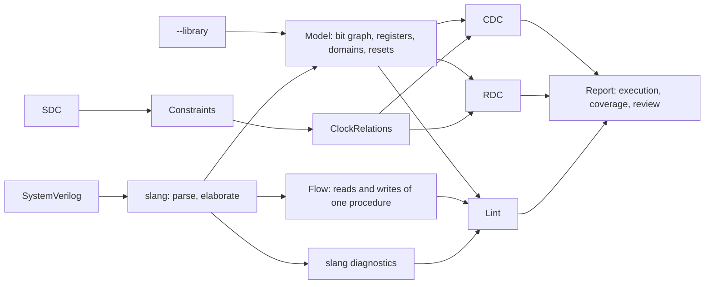
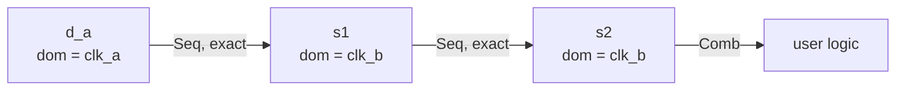
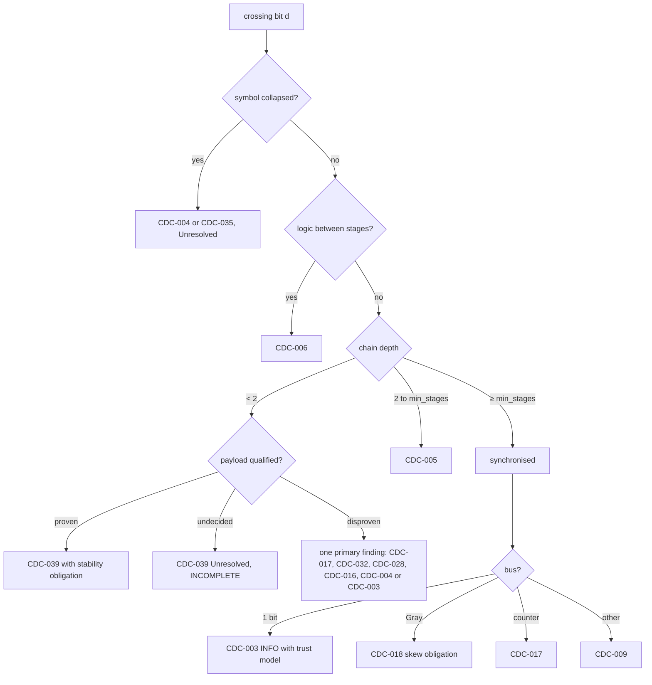
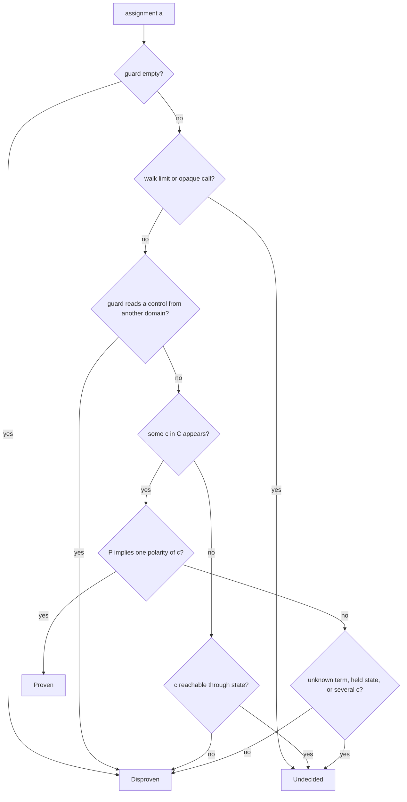
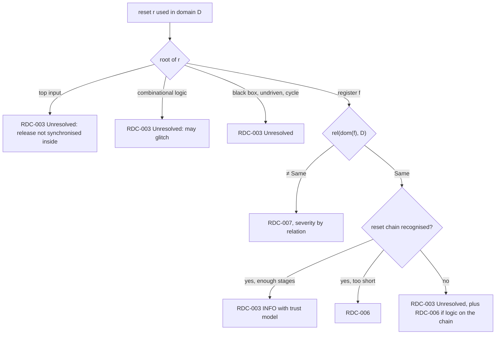

# How the analyses work

What the tool actually decides, so a result can be checked against it. Triggers and severities per rule are in the family docs; status per rule is in `catalog.json`.

**No ERROR means no established violation under the assumptions below. It does not mean the design is correct.**

Every analysis has three possible answers, and the third is never treated as the first:

```text
holds(x)     established, reported with the trust model it relies on
violated(x)  established, reported as a violation
unknown(x)   reported as Unresolved, at least WARNING, scope marked INCOMPLETE
```



## Prerequisites of every run

| The run assumes | If it does not hold | So you should |
|---|---|---|
| **One configuration.** Only the elaborated parameters are analysed; logic behind a constant-false condition is not. | Other configurations are not covered. | Run each configuration that matters (`-G`). |
| **One mode.** `set_case_analysis` selects one operating mode. | CST-014 warns that the other values are not covered; coverage stays INCOMPLETE. | Run each mode. |
| **Declared clocks.** Clock relationships come from the SDC and are trusted, not checked against intent. | Undeclared: crossings are Unresolved, never safe. Declared wrongly: a real crossing can be hidden. | Review the SDC as design input. |
| **A complete design.** Every module has source. | A module without source is a black box, Unresolved unless `--library` describes it. Library descriptions are trusted. | Supply source, or declare and review the cell. |
| **RTL only.** | MTBF, skew, routing delay, recovery/removal and timing closure cannot be shown. They stay obligations on every design. | Close them with timing tools. |

### What the SDC reader applies

The evaluator is bounded, not Tcl: its limits are in the [RFC](../SVerity_RFC.md#4-rules). A command it cannot evaluate applies nothing (it is atomic) and is disclosed by CST-009 or CST-018; dependent values are never guessed.

| Command | Effect | Not applied, disclosed instead |
|---|---|---|
| `create_clock`, `create_generated_clock`, `set_clock_groups` | Domain names and relationships | Generated relationships are assumed, not derived (CDC-030) |
| `set_input_delay` | Input contract for CDC-029 | Does not declare a clock relationship |
| `set_output_delay` | External capture clock for CST-012, with `-min`, `-max` and `-add_delay` (each contract on a port is checked) | Does not prove timing; `-rise`, `-fall`, `-clock_fall` and `-reference_pin` limit or move a contract and are not applied |
| `set_case_analysis 0\|1` | Top-level data inputs, scalar or named bits of a vector declared `[N:0]` (`mode[0]`, `mode[*]`): the model is rebuilt with those constants. A bit nothing fixes stays unknown, so `mode == 2'b01` is decided only when a fixed bit differs or every bit is fixed. An undriven internal object takes the value as a stated assumption (CST-014 says so, and its lint finding stays). A driven one is accepted only when its one driver already proves the value, counting a child output as a driver, because overriding a driver would let a mistaken constraint delete the defect being checked; a contradiction is not applied. Any procedural write, a force, a declaration initialiser, a primitive and a net alias rule a value out, whatever form the write takes, such as `{<<{m}} = 1`, `m++` or a `ref` argument. Only the written root of a target counts: an index (`v[m] <= x`), an input argument and a displayed value (`$display(m)`) are reads and leave `m` free to take a value. Selections, concatenations, equality and reductions are evaluated; other logic and `case` statements keep every branch, which can only add findings. | Unapplied, CST-009 with a reason: a whole-vector name (tools differ on what it means), other declared ranges, structs, a driven target whose single continuous driver does not prove the same value, one with several or unresolved drivers, an object the model does not see written (see the order below), a register output, an undriven object in a module with shared symbols, and clock and reset event sources. Conflicting values apply nothing. |
| `source`, `foreach`, `if`/`elseif`/`else`, `set`, `$var`, `all_inputs`, `all_inputs -no_clocks` | Bounded evaluation; conditional branches require a decidable `expr` condition. `-no_clocks` leaves out ports and port bits declared as clocks anywhere in the constraint set, whatever the order, so a clock declared later only removes a contract; a clock nothing declares stays in. | Unsupported options, cycles, excessive depth, undecidable reached conditions |

Clock declaration history is retained for diagnostics, while the latest same-name definition owns its targets in domain naming. `-add` suppresses the override warning; multiple clock names on one target still map to one domain name (the first matching active declaration), so alternative clock modes are not enumerated. Generated source objects and explicit master names are retained separately. Their declared ancestry is checked against clock groups, including transitive ancestors; it never proves RTL derivation or synchrony. Clock groups take precedence: the first separating group supplies Async or Exclusive even for an invalid generated master; with no separating group, distinct names remain Unknown.

Case analysis prunes only what it proves: logical AND/OR/NOT, scalar bitwise NOT, non-narrowing conversions, selects, concatenations, equality and reductions, propagated through single unconditional scalar drivers to a fixed point. A call in a condition blocks pruning, even with a false conjunct. Lint still reads the elaborated source.

**A case value is an assumption, not evidence.** It can remove findings, so a mistaken one must not delete the defect being checked. Each target therefore takes the first answer that applies:

```text
conflicting values              → nothing applied, CST-018
struct or interface member      → not applied      not followed as a plain signal
offset ≠ declared index         → not applied      [0:1] has mode[0] as its top bit
reset or clock source           → not applied      no state for "stopped" or "held" exists
register output                 → not applied      nothing shows it holds over time
written procedurally in any form → not applied      also forced, initialised, or tied to a primitive
                                                   or alias: a case value only stands in for no driver,
                                                   or agrees with one continuous driver
no driver, one instance         → applied, stated as an assumption (the lint finding stays)
no driver, shared symbol        → not applied      one value would reach the other instances
more than one driver            → not applied      counting a child's output or inout
one driver proving the value    → applied
one driver proving the opposite → not applied, a contradiction
one driver, value not proved    → not applied      overriding it is not implemented
```

A declaration is atomic, and a proof may use only declarations that were themselves applied, so they are retried until nothing changes.

A bit nothing fixes stays unknown, and the evaluator has three bit values rather than two:

| Expression, with `mode[1]=1` and `mode[0]` unfixed | Decided as | Why |
|---|---|---|
| `if (mode)` | true | one known 1 makes the value non-zero |
| `&mode` | unknown | the unfixed bit decides it |
| `\|mode` | 1 | one known 1 decides it |
| `mode == 2'b01` | false | the top bit already differs |
| `mode == 2'b11` | unknown | the other bit could still differ |
| `q <= {mode[1], data}` | keeps `data` | true as a condition, yet the other bit still carries the crossing |

The last row is the trap in this evaluator: being non-zero fixes a condition, not a value. Only a one-bit value drops its reads outright.

Unsafe designs these rules keep flagging: a child output that holds a wired-OR at 1 while `en=0` suggests 0 (`unknown_second_driver_in_child`), `initial force m = 1` (`unknown_forced_net`), `logic m = 1` (`unknown_declaration_initialiser`), a task called from `initial` (`unknown_write_in_called_task`), `buf(m, en)` (`unknown_primitive_driver`), `wire m = 1'b1` with a request for 0 (`unknown_driven_contradicts_driver`), a value on `u0` that must leave sibling `u1` alone (`boundary_sibling_instance`).

Why a clock or reset source stays out: a stopped clock does not make its registers constant, because an asynchronous reset can still change them. A released reset does not say what the registers start from. An asserted one is a statement about initialisation. One net can also reset different registers at opposite polarity, so its value is not a global "reset off". This needs retained state and per-register reset state in the model, and pruning `if (!rn)` alone would leave the event list and the reset metadata disagreeing.

## The model: what we read from slang

slang gives the elaborated design. From it, one model is built per run, and every CDC, RDC and model-based lint rule reads the same one.

```text
Graph      G = (V, E)
Node       v ∈ V      one bit of one signal in one instance  (inst, sym, bit)
Edge       u → v      u influences v, with:
             type     Comb | Seq (D side of a register) | AsyncCtl (async reset/set pin)
             exact    pure bit move, no logic on the path
             ctrl     u is a condition (enable or select), not data
             op, inv  innermost operator, polarity (0, 1, unknown)

Register   f ∈ F      per bit: q, clock, domain, edge, async resets and the value each
                      forces, sync-reset candidate, blocking?, released value
Domain     dom(f)     the root of f's clock, traced back through aliases
Guards     P_a(f)     Boolean condition under which assignment a of f moves data
Relation   rel(A, B)  Same | Async | Exclusive | Unknown, from the SDC only

Cone       cone(f) =  { r ∈ F ∪ inputs | r reaches f.D through Seq, then Comb edges }
                      the walk stops at registers; it also collects black boxes,
                      nets with no driver (a constant is a driver, a loop index is not a signal),
                      truncated drivers and unresolved calls
```

For example, `s1 <= d_a; s2 <= s1;` clocked by `clk_b`, with `d_a` launched by `clk_a`, becomes:



```text
rel(clk_a, clk_b) = Async   ⇒   d_a → s1 is a crossing, s1 → s2 is its synchroniser
```

A hub stands in for a large all-to-all assignment: `sources -> hub -> targets` states the same dependencies with fewer edges. A signal can be both data and enable of one target, and those stay separate edges, because `if (s) t <= s` holds `t` when `s` is low and so is no synchroniser stage.

**Why bit precision matters twice.** Treating `a & b` as "every bit of `a` and `b` reaches every bit of the result" looks only imprecise, but on OpenTitan AES it invented a dependency that produced a false ERROR, and it accounted for most of the 4.59 million edges. Keeping bits apart where the operator does removed the ERROR and took the graph to 454,185 edges and the run from 118 s to 4.6 s. Wrong edges cost accuracy and time together, so look for one cause before treating them as separate problems.

The same mistake showed up in struct patterns. OpenTitan's `tlul_adapter_sram` builds its response with `'{d_valid: ..., a_ready: ...}`, and treating that as one expression made `a_ready` depend on `d_valid`. That closed an invented combinational loop (a false Established LNT-012 ERROR on `otp_ctrl` and `spi_host`) and a false path from FIFO storage to its `full_q` (two RDC-010 warnings each). The same design written field by field had neither. A pattern's elements come most significant first and already resolved, so written order and `default:` need no separate handling: `'{r: b, d: x}` stays free of a loop, and a real one through `'{d: x, r: s.d}` or `'{default: x}` is still reported.

**Repeated edges are merged, not picked from.** One signal can reach one target several times in one procedure with different attributes. `if (reinit) q <= 0; else if (wr_en) q <= d;` makes `reinit` guard `q` on both branches. Compaction keeps one edge per source, target, type, procedure and role, and the survivor says what the repeats share: differing polarity becomes unknown, differing branch becomes none, differing operator becomes other, `internalRead` is kept only if all do. An approximate edge and a precise one stay apart: merging them would hide a loop that only the precise edge closes. Keeping the first repeat instead made the result depend on input order (see [Determinism](#determinism)).

**Precision loss is recorded, never silent.** It becomes a model fallback (CST-010) or a leaf in the cone, and any rule that reaches it reports Unresolved:

- A signal over 16384 bits collapses to one node, so nothing bit-level can be concluded.
- A register assigned by several sequential blocks keeps every block's clock. Each relationship takes the least safe of them, so the verdict does not depend on source order. Which block's value the register holds is not modelled, so every cone reaching it stays unresolved.
- Interface ports and references are not followed as ordinary nets.
- Subroutines: arguments and nonlocal reads in the body join the cone, cached per elaborated subroutine. Automatic locals hold nothing between calls, so they add nothing; one read before it is assigned holds no signal either, so no dependency is lost (LNT-044 reports the read). A function returns on every path when each path ends in a return, when every item of a `case` and its default do, or when unconditional statements write constant selects of the return value that together cover it. A pure value system function (`$clog2`, `$bits`, `$signed`, the dimension queries) reads nothing but its arguments. Recursion, static locals, ambiguous state ownership, unresolved effects or a budget stop leave an uncertain call on that cone. A side-effect write is an unresolved capture, never an exact transfer. The function's name is never evidence.
- A nested AND/OR mix on an edge is classified `other`.
- **Bits stay apart only where the operator keeps them apart:** exact moves, `~`, `&`, `|`, `^`, `^~` of equal widths, concatenation, assignment patterns that fill a packed value (`'{d: x, r: b}`, `'{x, b}`, `'{0: x, 1: b}`), conversions (a signed extension copies the top bit) and the data arms of `?:`. Everything else, including arithmetic, shifts, reductions and a `?:` select, is a leaf whose reads reach all its bits. Removing an edge here must be justified by the operator, because a missing edge is a missed crossing.

**Blind spots.** Function values, procedural order inside a call, output and `ref` transfers, persistence of local or package state, and initial and final processes are outside the register model.

## CDC

### What we look for

| Problem | In plain words | Rules |
|---|---|---|
| Missing synchroniser | A register samples a signal from another clock and can go metastable. | CDC-003, 004 |
| Broken synchroniser | Too short, logic between stages, a tapped stage, mismatched clocks or resets. | CDC-005, 006, 007, 026 |
| Glitch before capture | Logic before the first stage can pulse, and the pulse can be sampled. | CDC-008 |
| Incoherent bus | Bits synchronised separately can arrive in different cycles. | CDC-009, 032 |
| Reconvergence | Separately crossed signals meet again, and their relative order is lost. | CDC-010 |
| Payload protocols | Data captured when a synchronised control says it is valid. | CDC-016, 028, 039 |
| Gray pointers and FIFOs | One bit changes per step, so a late sample is still a valid value. | CDC-017, 018, 034 |
| Toggle and handshake | Events and request/acknowledge loops between domains. | CDC-014, 015, 024 |
| Clock structure | Gates, muxes and generated clocks that can glitch or change the domain. | CDC-019, 020, 030, 031, 045 |
| Boundaries | Top-level inputs and outputs, black boxes, memories. | CDC-029, 023, 035, 046, CST-012 |

### What we read

Registers with their domains, `rel`, cones, exact and control edges, guards `P_a`, and source expressions for Gray recognition.

### How we identify it

**1. Find crossings.** For each register `d` and each source register `s` in its cone:

```text
crossing(s, d)  ⇔  dom(s) ≠ dom(d) ∧ rel(dom(s), dom(d)) ≠ Same
```

Bits are grouped by source and destination symbol, so one bus is one crossing group. The relationship sets the severity of a violation:

```text
sev(Async) = ERROR      sev(Unknown) = WARNING, Unresolved      sev(Exclusive) = INFO
```

**2. Classify each destination bit**, then report per group:



**3. Synchroniser chain.** `s1 … sn` is a chain for a crossing when:

```text
first(s1)    ⇔  no control edge into s1 except a recognised sync reset
                ∧ s1's next value does not depend on s1
                ∧ no unresolved call on its cone

next(si, t)  ⇔  dom(t) = dom(si) ∧ t and si are nonblocking
                ∧ every Seq edge into t comes from si (or its aliases), or is t's sync reset
                ∧ at least one of those edges carries data, not only an enable
                ∧ no unresolved call on t's cone

clean        ⇔  each next edge is exact,  otherwise CDC-006
                ∧ same edge and same resets per stage,  otherwise CDC-026
                ∧ stages short of min_stages feed only the next one,  otherwise CDC-007
```

So `if (s2) held <= 1` makes `held` a consumer, not a stage, and a "reset" driven by a later stage of the chain is feedback, not a reset. CDC-006 and CDC-007 are separate findings on one crossing only when both defects exist, because they have different fixes.

**Where a chain ends is the hard part.** Finding the start is easy; the walk has to decide what counts as the next stage, and whether anything else may read a stage. Four shapes, all after `s1 <= a_q; s2 <= s1;`, with `min_stages` at its default of two:

| What follows | Reading | Result |
|---|---|---|
| `consumer <= ~s2;` | Logic after two clean stages: a consumer | Recognised 2-stage chain |
| `s3 <= s2; tap = ~s2;` | `s2` has reached the required depth, so it is already an output, and `s3` is a pipeline register or a third stage | Recognised, no CDC-007. At `min_stages=3` it is 3 stages with a tap, CDC-007 |
| `tap = ~s1;` | Read before the required depth | CDC-007 |
| `s2 <= ~s1;` instead | Logic before the chain has two stages | CDC-006 |

An exact continuation is the next stage wherever it comes in the source, so swapping independent assignments changes nothing. The stage that reaches the required depth is the synchroniser's output, and so is every follower, for qualifier and reconvergence checks too, so an unused follower changes no result. Checks that compare the synchroniser with its source (CDC-041) use that output stage, never a follower. A chain short of the required depth has no output: its last stage stands in, marked short, so CDC-005 reports the chain and a payload it qualifies stays Undecided (CDC-039). Clock edge and reset agreement (CDC-026) are required only of the stages up to that depth.

The second row does not report CDC-007 merely because a register has a follower: the question is whether the chain has been through the required depth, not whether this is the last register. OpenTitan's `prim_diff_decode` and `uart` show why: each follows a clean `prim_flop_2sync` with a pipeline register for edge detection or majority voting and also reads the output directly, and both are correct.

With `min_stages` above two, the first row stops at two stages and reports CDC-005, not CDC-006.

The first row is not a broken third stage: a capture of the real last stage in another domain would otherwise look like a leak from a middle stage, as on OpenTitan `clkmgr`, where 8 clean `prim_flop_2sync` crossings would each get a false CDC-006 and CDC-007. The public gate designs do not exercise it.

- **Assumes:** the first stage resolves within one destination cycle, and the source is glitch-free and held long enough. This is the stated trust model, not a proof.
- **Does not show:** that logic before the first stage is safe. That is CDC-008, and such a chain can still be recognised.
- **Must stay flagged** (as CDC-028 with CDC-003 as evidence): `CDC-003/bad_first_stage_enable`, `bad_first_stage_hold_mux`, `bad_blocking_pipeline`, `CDC-028/bad_stage_enabled_by_its_own_data`.

**4. Synchronous reset candidate.** A register's control edge is ignored for chain recognition only if it looks like a reset:

```text
syncReset(c, f)  ⇔  c is one named 1-bit signal, possibly negated, forcing constants on f
                    ∧ ( c is the block's first branch
                      ∨ c is a final if with no else, after one unconditional exact NBA to that bit )
```

- **Does not show:** that `c` is really a reset. This is a heuristic on form, and `c` may be X. It stays in the graph, so a guard from another domain is still a crossing.
- **Must stay flagged:** `CDC-003/bad_trailing_nonconstant`, `bad_trailing_reset_not_last`, `bad_trailing_source_guard`.

**5. Payload qualification.** For a bit with no chain, let `C` be the outputs of chains from `dom(s)` into `dom(d)`, and `P_a` the guard of each data-moving assignment `a`. Guards become Boolean formulas. Registers and unsupported terms become free atoms, so they can only weaken the proof.

```text
proven(a)    ⇔  ∃ c ∈ C:  (P_a ⇒ c)  ∨  (P_a ⇒ ¬c)            checked by enumeration
qualified    ⇔  ∀ a: proven(a)
```

A proof that leans on a chain short of the required depth is Undecided, not proven: that qualifier may itself be metastable when it opens the capture.



The limits are 12 atoms, 256 facts and 64 reached nodes; past them the result is Undecided.

- **Does not show:** that the payload is stable while captured (it stays a WARNING), or that a FIFO's valid belongs to the slot being read.
- **Must stay flagged:** `CDC-028/bad_or_bypass_temporary`, `bad_qualifier_wrong_destination`.

**6. Gray and counters.**

```text
gray(s)     ⇔  every nonconstant write of s is  b ^ (b >> 1), with both b the same value,
                  inline, or in a single-statement function with that elaborated body
                  and matching width and signedness; or an XOR of adjacent bits of one vector
                ∧ b is counter-like
counter(S)  ⇔  some bit of S has another bit of S in its cone          (carry)
```

- **Does not show:** that the value only steps by one, or the skew between bits. Skew is the CDC-018 obligation.
- **Unknown:** a value from any other function is Unresolved, never called a counter or Gray.
- **Must stay flagged:** `CDC-017/bad_gray_of_data`, `mut_binary_pointer`, `unknown_misnamed_binary_function`; `CDC-009/bad_gray_of_different_slices`.

**7. Protocols.** Each is recognised from structure and reported with an obligation (CDC-024). None is proven.

```text
toggle(s)      ⇔  s depends on itself ∧ s is synchronised ∧ receiver XORs the chain with its delayed copy
handshake(a,b) ⇔  a and b are synchronised single bits in opposite directions
                  ∧ each one's source depends on the other's chain     one way only: CDC-015 WARNING
fifo(g1,g2)    ⇔  gray(g1) ∧ gray(g2), in opposite directions, same instance
```

**Same launch bit, several chains (CDC-047).** A launch bit with chains into two or more destination symbols of one domain is reported: the copies can differ for a cycle. This is the structure, not proof that logic combines them.

**8. Reconvergence (CDC-010).** A destination cone with two or more asynchronous influences is reported: separately synchronised source bits, raw unqualified crossings, or signals that passed one pipeline register after their synchronisers. This is a structural heuristic, not a proof of glitch freedom.

**9. Subroutines.** Reads in a function body join the cone, so feedback through a function disqualifies a first stage. Dependencies alone prove neither Gray encoding, nor qualification, nor stability.

- **Must stay flagged:** `CDC-003/bad_hidden_function_read`, `bad_nested_conditional_function`, `bad_package_hierarchical_function`, `bad_hidden_function_feedback`; `CDC-004/bad_function_body_and_argument`; `CST-010/unknown_recursive_function`, `unknown_subroutine_side_effects`.

**10. Output boundary (CST-012).** For an output with a valid `set_output_delay -clock X`:

```text
∀ launch register r in the output's combinational cone:  check rel(dom(r), X)
```

Feed-through inputs, no launch register, mixed domains, opaque calls and black boxes cannot establish a contract, but a known asynchronous launch stays a violation even when the rest of the cone is unknown. A final synchroniser stage is a launch register. Outputs with no delay are not warned one by one. This does not show physical timing or the receiver's protocol.

- **Must stay flagged:** `CST-012/bad_async_launch`, `unknown_mixed_domains`, `unknown_feedthrough`, `bad_function_hidden_state`, `unknown_relationship`, `bad_upstream_synchroniser`, `unknown_opaque_call`, `unknown_blackbox`, `unknown_multiple_sequential_drivers`.

## RDC

### What we look for

| Problem | In plain words | Rules |
|---|---|---|
| Unsafe reset release | Release must be synchronous to the clock it resets, or registers leave reset in different cycles. | RDC-003, 006, 007, 016 |
| Reset built from logic | A reset from gates or other registers can glitch or race. | RDC-008, 009, 014, 017, 019 |
| Data across reset domains | The source resets while the destination runs, so the destination sees an unplanned change. | RDC-004, 005, 010 |
| Sequencing | Order of resets and release across FIFOs and handshakes. | RDC-011, 023, 024, CDC-041 |
| Inventory and limits | Sources, polarity, and what RTL cannot show. | RDC-001, 002, 012, 013, 029 |

### What we read

Per register bit: async resets and their roots, polarity by edge, the value each reset forces, the exact released value or source, plus `rel` and cones.

### How we identify it

**1. Classify each reset per receiving clock domain.**



**2. Reset synchroniser chain.** Walking `f1 … fn` back from the output, with `a` the asserted value:

```text
chain(f1…fn)  ⇔  a ∈ {0, 1} ∧ all downstream reset users agree with a
                 ∧ ∀i: fi nonblocking ∧ clock resolved ∧ same edge and domain
                 ∧ ∀i: fi has the same async reset root and polarity
                 ∧ ∀i: fi's assertion assigns exactly a, in a known two-branch transition
                 ∧ first stage releases to the constant ¬a
                 ∧ each later stage releases exactly to the previous stage
```

A known transition needs a simple reset conditional, with straight-line branches and one nonblocking write per bit in each branch. Concatenated and individual writes are the same. Nested conditions, enables, loops, timing controls, opaque calls, X or Z values do not establish it, and having no data edge does not prove a constant. Library flops use their declared reset value, polarity and data port.

- **Assumes:** nonblocking stages resolve metastability, under the same trust model as CDC. Library cells are trusted.
- **Does not show:** release order, recovery/removal, minimum pulse width, retention or isolation. These are obligations or need power intent.
- **Unknown:** an unrecognised chain is Unresolved and marks reset extraction INCOMPLETE.
- **Must stay flagged:** `RDC-003/bad_blocking_stages`, `bad_inconsistent_assertion`, `bad_asserted_release_constant`, `bad_opposite_clock_edges`, `bad_unknown_release`, `bad_high_impedance_release`, `bad_downstream_polarity`, `bad_opposite_raw_polarities`, `bad_third_stage_assertion`, `bad_data_fed_chain_is_not_a_synchroniser`; `RDC-006/bad_single_stage`; `RDC-016/bad_stage_tap`.

**3. Data across reset domains.** Let `resets(f)` be the async reset roots of `f`:

```text
mismatch(s, d)  ⇔  s ∈ cone(d) ∧ resets(s) ⊄ resets(d)
RDC-004  if dom(s) = dom(d)        RDC-005  if rel(dom(s), dom(d)) ≠ Same
```

One finding per destination register and pair of reset sets; each source is listed as evidence, because a foreign reset feeding a whole bus is one cause. This is a structural mismatch, not proven corruption. Even a recognised data synchroniser leaves it open: its trust model covers metastability, not whether the destination tolerates a reset-induced change. So it stays a WARNING with proof NOT_ATTEMPTED.

## Lint

### What we look for

| Problem | In plain words | Examples |
|---|---|---|
| Language and elaboration | Illegal or suspicious code the compiler can see. | LNT-001, 002, 004, 065 |
| Structure | Drivers, cycles and connectivity of the elaborated design. | LNT-012, 027, 042, 047 |
| Procedure behaviour | Latches, overwritten values, reads before writes. | LNT-013, 025, 044, 053 |
| Width and arithmetic | Values lost or changed by sizing. | LNT-035, 036, 057, 073 |
| Reset and initialisation | State with no defined start, reset branches that do not reset. | LNT-054, 067, 070 |
| Synthesizability and race | Constructs that simulate differently from hardware. | LNT-015, 019, 060, 063 |

### What we read

Lint uses the view that fits the question. Each rule has one. Every view is of the elaborated hardware: a definition the top never instantiates is elaborated by slang only for its own diagnostics, with drivers unbound, so native rules do not walk it (slang still reports it unused, LNT-011), and every source file of a `--single-unit` run is user code.

| Source | Gives | Limit |
|---|---|---|
| **slang diagnostics** | Compiler warnings, mapped to rules. | Inherits slang's limits on case coverage and `continue`. |
| **AST** | Expressions, types and widths, by query. | Sees source shape, not values. |
| **Flow** | For one procedure, reads and writes in order, with reaching definitions and path guards. | Below. |
| **Model** | The bit graph above. | Fallbacks recorded in coverage. |

```text
Flow, for procedure p:
  access   read or write of a bit range, with its guards
  write    exact?  blocking?  live at the end?  used by some read?
  read     reaching writes; entryOnly: only the value from before p can be seen
  Kill(v, w)        w replaces v on some path
  exclusive(a, b)   a and b can never run in one activation
```

### Evaluation depth for loop proofs

A select in the first condition of an `if` or `?:`, the selector of a case, or
the left operand of a short-circuit operator is evaluated whenever that construct
is reached. It is not conditional on which branch is later selected. Shared
loop proofs keep these expressions at the enclosing evaluation depth, while
visiting branches, subsequent conditions, case items and short-circuit right
operands at guarded depth. This lets an unconditional counted loop establish
that a select in its condition reaches an out-of-range index without claiming
that a guarded branch executes on every iteration.

This shared depth serves both index-range checks and dynamic driven-bit proofs.
These are execution-order facts, not path-feasibility proofs. Nested loop
conditions remain conservatively guarded; short-circuit right operands and
branch bodies require the existing range/path assumptions. Unknown input ranges
are not inferred from the absence of a default-mode finding.

### Upstream finding identity

An inferred-latch diagnostic retains slang's procedure location and hierarchy.
When its structured value-path argument exactly resolves to a variable, port or
net in the procedure's containing scope, the frontend also records that target
in `signals`, provided same-named AST references all identify that exact symbol.
Local shadows therefore receive no guessed module-level identity. This links the warning to the affected value without broadening
source-line matching or parsing prose. Compound paths that cannot resolve exactly
receive no guessed signal identity; the warning itself remains visible.

### Elaborated lint scope

Semantic AST lint visitors operate on the selected hardware configuration. The
shared `HardwareVisitor` rejects symbols in an uninstantiated scope or beneath
an uninstantiated ancestor before dispatching rule handlers. This matters when a
nested generate block looks active locally but its parent was not selected.
Activity is checked in the elaborated scope chain, never by source location:
the same source can be inactive in one parameter specialization and active in
another. Active canonical specializations retain their separate checks.

LNT-051 deliberately uses raw AST traversal to inventory configuration choices.
Skipping an inactive scope in a semantic check proves nothing about that scope
under another configuration. Slang diagnostics and model construction have their
own traversal contracts; this gate does not alter either. Local expression walks
are safe only when reached from an active semantic scope; new whole-design lint
visitors must use the shared gate rather than raw `ASTVisitor`. Slang
`--lint-only` marks all scopes uninstantiated and therefore does not provide
hardware semantics for these checks; its existing upstream-scope INCOMPLETE
disclosure remains mandatory.

### How we identify it

```text
LNT-013 latch      ∃ variable with unassigned bits at the end of p               (legacy always)
LNT-025 conflict   conditional writes v before w, same kind, static ranges,
                   range(v) ⊆ range(w), ¬exclusive(v, w), values may differ
LNT-044 read       read with entryOnly ∧ a later covering write in p; or a read whose bits split into
                   entry-only (Sole), entry-or-written (Some) and maybe-filled (Unsure) segments, with a
                   later write over them
LNT-053 dead       Kill(v, w), both exact, same kind, range(v) ⊆ range(w),
                   no read between, not observed, not in a loop
LNT-012 cycle      a Comb-only self-dependency, or a Comb strongly connected component, where a bit its
                   procedure reads only after writing has a separate node for that internal value
LNT-027 clock      clock root reaches a register D or an output through Comb edges
```

**Flow limits.** Flow never claims more than it walked, and a rule that depends on these reports Unresolved:

- Loops are walked once, so no overwrite claim crosses iterations. A loop that is not followed through its iterations sets `walkedOnce`: a `while`, `do`, `repeat` or `forever` loop, a `for` loop that is not unrolled, and a `foreach` that is not followed. A `foreach` over fixed-size dimensions is followed through its iterations (one step each, against the same budget) when its body has no `break`, `continue`, `return` or `disable`: the base class joins a loop's end state with its breaks, which would apply later iterations' writes to the paths that left. The array named in its header supplies the dimensions and is not read. A walked-once loop makes a result Unresolved only when it matters: LNT-013 (b), (c) and the "cannot be proven" findings need a dropped path (`pathsDropped`: a `continue`, an unmatchable case item), since definite writes outside the loop decide coverage. An entry-value read (LNT-013 (d), LNT-044 on automatic locals) is Established only when some bit of it can still be the entry value with no write that could fill it on the way (`entryHard`): a write with a run-time index, or one inside a walked-once loop, may be that fill, so the read is Unresolved. A run-time index is bounded by its own width (`o[i]` with a 2-bit `i` reaches 4 bits), so a bit no index can reach stays Established.
- A user call or a mid-body timing control makes the procedure `opaque`.
- A `continue`, or a case whose items cannot all match, makes it `approximated` (slang's base analysis sets the state unreachable at a `continue`, so every iteration after a decided one vanishes from an unrolled loop).
- A `for` loop is unrolled within a budget of 8192 steps per procedure, shared by all its loops (one step per iteration, nested loops weighing more; slang restarts its count for each loop, so the limit handed to each outermost loop is what the earlier ones left). A loop that is not unrolled, for the budget or any other reason, is walked once with its counter unknown: the procedure is `approximated` and `truncated`, and a latch, unassigned range or read-before-assign that depends on the end state is Unresolved. A `for` loop is unrolled when its counter is declared by the header, or is a variable the header initialises that nothing in the body can write (slang refuses a static one, so the base class sees it as automatic while the loop is walked: nothing else runs inside one activation, and a module-level counter whose body calls a subroutine is refused), and its initial value, bound and step are constants. Slang also reports a loop whose first test it cannot evaluate (a run-time bound) as never executing; we ask again without the steps, and walk such a loop once (`for (int j = 0; j < m; j++) y[j] = a[j];` leaves a latch). Cost is linear in the steps (a 65000-iteration loop: 0.2 s, 124 MB).
- `++`, `--` and compound assignments are a read of the bits they write followed by the write (`Access::step` ties the `++` read to its write). The combinational model gives `x++` the edge of `x = x + 1`; a later compound write that keeps each bit in place (`+= -= ^= |= &=`, `*=` by an odd or run-time factor, `++`) carries the earlier value like `x = x + b`, and one that folds the old value away (`&= 0`, `|= ~0`, `*= 0`) does not. A loop counter (a `for` header variable, or a block local written only by `for` initialisers and steps and read only in that loop) and a procedure temporary (below) are no hardware state and take no part in a self-dependency or cycle; any other local is analysed like a module variable, and a static local read before it is written is state (LNT-013). A `++` or `--` inside a condition or index is a read and a write before the branch it decides.
- Guards are not kept as full AND/OR trees.

**LNT-012 and statement order.** A procedure's own reads of a bit it always writes first are not feedback, so those reads use a second node fed by the procedure's writes. A cycle made only of second nodes is one activation's statement order: no finding. Any cycle that touches a real bit stays, so a loop that leaves the procedure still closes. This relies on a loop back edge carrying only values written inside the procedure: walking a loop once cannot hide a read of the entry value.

**Procedure temporaries.** `analysis/temps.h` walks each procedure and subroutine body in statement order and finds the variables whose every read follows a write of the whole variable in the same activation (a blocking assignment, typically the `for` initialiser; a nonblocking or partial write defines nothing). Conditions meet by intersection, a loop body is entered with what its initialisers wrote and leaves nothing behind, and a timing control, `fork`, pattern `case` or assertion clears what was written and exposes what it names. A module-level variable is a procedure temporary when no read in any procedure or subroutine is exposed, some read exists, a procedure writes it, and nothing outside procedure bodies names it (a continuous assignment, a port connection or port, a hierarchical reference, an interface member). It carries no value between activations or processes, so it takes no part in LNT-009 (d) as the variable (its drivers are not multiple drivers), no cycle or self-dependency of LNT-012 passes through it, and a `for` loop over it with a constant start, bound and step is proven for LNT-008, LNT-024 and LNT-041 as a block-local counter is. A variable with any nonblocking write is never a temporary: a flop drives it, including through a select, member or conversion inside a concatenation, streaming concatenation or assignment-pattern target (`{t[0], u[0]} <= ...`, `{<<{t}} <= ...`); the roots of a target are collected separately from the predicate that a write defines the whole variable. (A blocking write in a clocked procedure, read there only after it is written, builds no flop and keeps the variable a temporary.) A callee that reads it before writing it exposes it. The same walk, per procedure, tells the model which reads see only the procedure's own value even where `Flow` is approximate (a `continue`, a loop it did not unroll, a call): a variable read in a called subroutine before that writes it is excluded. It does not show whether another process writes a temporary between a write and a read of it (no timing control: none runs); a variable written by two processes and read by neither is not a temporary.

- **Must stay flagged:** `LNT-009/bad_shared_counter_read_before_loop`; a counter read by a continuous assignment, a nonblocking-initialised or conditionally initialised one stays state. Must stay silent: `LNT-009/boundary_counter_read_after_own_loop`, `LNT-012/good_shared_counter_with_call_in_loop`, `good_initialiser_dominates_reads_beside_continue`, `LNT-024/good_module_counter_loop_fills_output`.

A self-dependency inside one combinational procedure is a certain loop, not a statement-order question, only when `Flow` shows the assignment reads the whole variable with `entryOnly` (every path still holds the pre-activation value), outside a loop, and writes the whole variable, with the call-free procedure walked exactly, and every mention of the variable runs through operators that keep bit k in place. The write must also reach the output: a later write that is not exclusive with it replaces the value, so `a = a ^ x; a = b;` is `a = b`, unless this write is still the final one on some path (`Flow`'s `live`: `if (c) a = b;`). A later whole write that reads the variable through bit-preserving operators composes the value instead (`a = a ^ x; a = a & m;`). An operand pair that folds the self term away (`a & 0`, `a ^ a`) is no loop either. Anything else, such as a slice, a shift, a concatenation or a write on only some paths, stays Heuristic.

- **Must stay flagged:** `LNT-012/bad_read_before_first_write`, `bad_conditional_first_write`, `unknown_call_keeps_warning`, `bad_loop_through_ordered_read`. Must stay silent: `boundary_write_before_read_on_every_path`. Certain: `bad_self_read_before_any_write`.

**LNT-012 and approximate edges.** An assignment with a computed index or a user call reaches every bit in the model, which may be far more than is real. So a loop that needs such an edge is Unresolved, and a loop that remains without them stays an ERROR. Port connections alone are one net seen from two sides, not a loop, and a constant selector reads nothing, even if it names a signal inside `$bits`. In a one-bit assignment with a computed index, a static select read beside it (`y = a[i] | a[0]`) is also emitted as a precise edge: it is a certain dependency, so a loop that needs only such reads is an ERROR. A multi-bit result or a call keeps every edge approximate, since a read there may not reach every target bit.

**Unrolled `for` loops in the model.** The model runs the header of a `for` loop in the constant evaluator (start, test and step constant, at most 256 iterations) and walks the body once per iteration with the loop variables bound, so a select on one names exactly its bits and the edges it makes are not approximate. Prerequisites: the body has no `break`, `continue`, `return` or `disable` (a later iteration may not run), calls no user subroutine and does not write the loop variables; otherwise the loop is walked once with the variables unknown, as before. The assumptions: every iteration runs (a loop that cannot be left early does), and the loop's own variable is not read by another process. A cycle that needs only exact edges of an unrolled loop is established; one that needs an approximate edge stays Unresolved. A constant write to a node (`x.f = 1'b1`, a struct default) is a constant driver of it, so a node written only by constants is not undriven. A `?:` whose condition is constant under the bound variables reads only its live arm, and `&&` / `||` with such a left operand read nothing of the right one (`ValuePath` visits every operand, so the model prunes them itself): `b[i] = g[i] ^ (i < N-1 ? bin[i+1] : 0)` is a chain, and the select in the dead arm, out of range for one iteration, does not read the whole vector. The unrolled walks of one procedure are budgeted (2048 body walks over all its loops, a nested loop counted once per enclosing iteration, so three nested loops of 16 cost 4096): a loop beyond what is left is walked once as an unrolled-not loop, which bounds the memory near the approximate walk's (the nested 64x64x64 shape that needed more than 2 GB unrolled runs in about 50 MB). Must stay quiet: `LNT-012/good_per_index_chain_in_for_loop`, `good_unrolled_loop_index_makes_no_cycle`, `good_dead_arm_of_conditional_in_unrolled_loop`, `good_dead_operand_of_logical_and_in_unrolled_loop`. Must stay flagged: `bad_loop_through_unrolled_for_loop_feedback`, `bad_loop_through_live_arm_of_conditional_in_unrolled_loop`, `bad_loop_through_live_operand_of_logical_or_in_unrolled_loop`; Unresolved: `unknown_cycle_through_computed_index`, `unknown_loops_over_the_unrolling_budget`.

A call that writes state (a task, or a function with output or inout arguments) gets approximate edges from its argument reads and the state its body reads to everything it writes; the model does not follow which input reaches which output. The statement-order exemption applies to those reads too: an inout argument, or state the body reads, counts as a read of the entry value only for the bits `Flow` cannot show written before the call (`Flow::entryRangesAtCall`). Primitives follow the same rule: tri-state and MOS gates are exact data and control edges into the output, while a tran-family switch or a user-defined primitive is all-to-all and approximate.

- **Must stay flagged:** `LNT-012/unknown_cycle_through_computed_index`, `unknown_cycle_through_function_argument`, `unknown_cycle_through_task_output`, `unknown_cycle_through_task_side_effect`, `unknown_cycle_through_function_output`, `unknown_cycle_through_tran_switch`, `unknown_task_inout_read_before_write`, `bad_loop_through_tristate_buffer`, `bad_precise_loop_beside_a_call`, `bad_cycle_without_computed_index`, `bad_selector_read_is_a_real_dependency`.

**LNT-012 and black boxes.** A box's body is not modelled, so each box is one node its inputs feed and its outputs read. Those edges are approximate like a computed index: a loop that needs one is Unresolved, at the box. Only a declared clock or a port declared synchronous to one removes a path.

- **Must stay flagged:** `LNT-012/unknown_cycle_through_black_box`, `bad_precise_loop_beside_black_box`.

**LNT-025 in detail.** Independent `if`s already give last-write priority in SystemVerilog, so an overlap of different values is a review question: Flow proves neither exclusivity nor intent. Two exemptions:

- **Equal values:** two known integral literals, equal after implicit conversions, on the same exact range, with no opaque call between. This proves that pair agrees, not that the protocol is right.
- **Text chains:** narrow, whole-target string-literal selection chains are INFO, as an assumed idiom. Every pair stays reported, and `LNT-025.priority_chains=warning` raises them. INFO here is an assumption, not a discharged obligation.

**Does not show:** intent, or the behaviour of user functions at the procedure level. The model follows function dependencies. Flow treats a user call as reading what its body names outside itself (through the bodies it calls, declaration initializers of block locals and loop variables included): only the live writes of those variables are exposed and only then is the procedure opaque; a function of its arguments, of parameters and of other variables leaves the procedure as it was. A task, a hierarchical name, a class or virtual method, a call with an output, inout or ref argument, a function with a static local (state between calls) and a call that loops back are taken to read anything.

**Value ranges (LNT-004, LNT-005, LNT-034, LNT-036).** One proof answers "is the value kept here": an interval of the values an integral expression can take, in `rules/lint/value_range.cpp`. A rule drops or demotes a finding only when the interval shows the value is preserved at that site; the width and sign findings slang reports are demoted to INFO with the proof as evidence (`value_preserved`), the native ones are not reported.

- **What it models:** constants and parameters exactly; a `for` loop variable by the loop facts LNT-005, LNT-006 and LNT-037 share (a constant start, a constant step towards a constant bound, no write in the body, up or down; every initializer is a plain declaration or assignment with no nested assignment, increment/decrement or potentially writing call, and no variable is initialized twice), with the value that ends the loop added inside the stop test; every other operand by the range of its width and signedness; and above these `+ - *`, left and right shifts, `& | ^`, `/` and `%` by a positive divisor, unary minus and `~`, a conditional (the union of its arms), a concatenation (the unsigned patterns at their offsets) and every conversion. A signed conversion or `$signed` of `{x[MSB], x}` or `{{k{x[MSB]}}, x}` preserves signed x's interval when x is the same named variable, MSB is its declared leftmost bit, k is a positive constant, and the result width is exactly the concatenation width. Other concatenations retain independent operand bounds. A conversion keeps the interval when it lies in the target type and otherwise gives the target's whole range, so wrap-around is never narrower than the truth. A conversion layer is value-preserving when the interval of what goes in lies in the type that comes out; the layers around an operand are checked one by one.
- **Nets:** a net or variable whose only driver is one continuous assignment of the whole of it has the range of that assignment's value (`assign xe = {4'b0, x};` keeps `xe` in [0, 15]), followed through a chain of a few such nets.
- **Assumptions:** initializer RHSs containing user calls are conservatively rejected, including input-only calls that could write module state. X and Z bits are not modelled; a loop variable declared outside its loop is taken as it is declared when the loop facts accept the loop (no write in the body, no call that could write it); types of at most 64 bits, and products and shifts that overflow 126 bits give the type's range.
- **Does not show:** a value that depends on an input contract, a guard or a call, except `$clog2` of a known range; an `input` formal has the hull of what every call in the design passes (computed once per design, kept on the model), but its type's range when the body writes it, when a call passes a value of unknown range, or when the function is a task, virtual or imported; a concatenation or replication converted to a signed type is never proven by value, since its value does not say what the author meant (only the manual sign extension below is). A definition no instance of the design uses is elaborated by slang with its parameters unresolved, so nothing in it is evaluated or proven: its LNT-004 and LNT-005 findings are INFO, evidence `definition_not_instantiated`, never dropped. The LNT-005 findings on constant arithmetic seen in the OpenTitan replays (`$clog2` into `int unsigned`, a package function of a parameter) are of this kind; they appear for library modules on the command line that the top does not use.
- **Prerequisites:** the proof sits on the node slang reports (a comparison's or operator's operator token, an implicit conversion's operand start, the start of an expression converted between packed types, a conditional arm's start); a location is demoted only when every instance body that reaches it is proven. Only canonical instance bodies and the packages are read, never an uninstantiated definition; the initializers of an enum's values and the conditions of generate blocks (also the blocks not elaborated) are read from the types and the blocks. slang retypes an arithmetic operand into the type of the comparison or operation that holds it before it reports, so the original signedness of such an operand is gone: a proof there needs a value range in the lower half of the type, where both readings agree. Parameter-override expressions of child instances (`.Width(NumShares * Width)`) are walked for every instance, since slang reads only the canonical body of instances with equal parameter values and each instance has its own override nodes.

**Decided or free (LNT-006 and LNT-037, non-constant part).** The same interval also answers whether an input is involved. An index or divisor is *determined* when constants and `for` loop variables with a known range alone fix it (arithmetic, shifts, conversions, conditionals and concatenations of those); a signal, port or call makes it free. A determined value with a computed range is a finding when the range leaves the array or reaches zero (Heuristic: a guard or `break` the analysis does not read can skip the iteration) and silent when it stays inside; a determined value whose range is only its type's (an operation the model lacks, such as `**`, or a wrapping counter) is a gap, never an obligation. A free value keeps the input-contract obligation unless the range its operations allow already lies inside (`x % 8`, `x & 7`). A wrapping counter's range covers only its leading iterations: it can show an overrun, never that the index stays in range. An affine index `s*i+k` takes its range from the loop's, both ends being values the loop takes, and is used only when no node wraps in its own type; a branch condition comparing the variable with a constant (also through `!`, `&&`, `||`, `?:` and `&&`/`||` right operands) narrows the loop's range for that branch only, over-approximating, so a guard is honoured only where it excludes the iteration. A free divisor is an obligation by default only when it reads design state; a subroutine's formal stays opt-in (`LNT-037.dynamic_divisor`), since a helper that no caller constrains (a package `ceil_div`) would be reported in every design that includes it.

**An approximation reaches only what it touches (LNT-013 outputs).** A loop walked once or beyond the unrolling budget makes Unresolved only the outputs some access inside it reads or writes (`Flow::touchedInWalkedLoop`); the other outputs' unassigned paths stay certain. A loop beyond the budget is not recorded per access, so it touches everything.

**LNT-005 value proofs.** slang reports each signed/unsigned mix; one is demoted to INFO only when the elaborated AST shows the value is preserved at its site, by the predicates in the LNT-005 spec. A same-width equality compares bit patterns and the manual sign extension `{a[W-1], a}` is matched by shape; every other proof is the value range above. LNT-005, LNT-006 and LNT-037 share one definition of a loop's step and of a write to its variable.

- **Prerequisites:** as for the value ranges. The write of a loop variable is found by `writesVariable`: a call that passes it as an output, inout or ref argument counts, and for a variable not declared by its loop so does any user call.
- **Does not show:** an enum, struct or union operand (an enum against a vector is a type question, not a value one), a loop whose bound is not constant or whose body writes the variable, and a signed value that can be negative.
- **Must stay flagged:** `LNT-005/bad_loop_starts_at_minus_one`, `bad_loop_steps_down_unsigned_bound`, `bad_loop_body_writes_variable`, `bad_loop_bound_is_unsigned_signal`, `bad_loop_variable_written_by_subroutine`, `bad_size_cast_loop_runs_to_nine`, `bad_size_cast_of_free_input`, `bad_manual_extension_wrong_bit`, `bad_manual_extension_constant_bit`, `boundary_manual_extension_target_one_bit_wider`, `bad_compare_constant_cast_sign_bit_set`, `bad_mixed_sign_negative_constant`, `bad_packed_view_width_differs`, `bad_packed_view_four_state_to_two_state`, `bad_packed_view_enum_elements`, `bad_case_two_enum_types`, `bad_case_selector_item_types_differ`.

**LNT-004, LNT-034 and LNT-036 on the value range.** LNT-004 demotes an arith-op-mismatch only inside an index, part-select bound or shift count (self-determined: no wider context decides the width) with one constant operand, and a width-expand on a conditional arm that slang evaluates at the target's width, or on an extension that keeps the value (zero extension, sign extension into a signed type, a non-negative range into an unsigned one; the extended operand must itself be clean: nothing inside it wraps or changes a value, and a sign extension an outer conversion reads as unsigned is proven only by a non-negative range); signal-with-signal mismatches, bitwise mismatches and conditionals of fill literals keep their finding. LNT-034 asks of a signed arm only that it cannot be negative, and of two arms of different width that the consumer keeps the low bits both agree on: the wider arm is `x +/- constant`, the consumer is an assignment or explicit cast no wider than the narrower arm, and no right shift or other operation lets upper bits flow down. LNT-036 (a) reports a product only when its interval leaves the evaluated width.

- **Must stay flagged:** `LNT-004/bad_index_scaled_by_signal`, `bad_index_scale_wraps`, `bad_conditional_product_exceeds_context`, `bad_arith_operand_widths_differ`, `bad_extension_signed_into_unsigned`, `bad_extension_signed_arm_into_unsigned`, `bad_extension_of_wrapped_sum`; `LNT-034/bad_conditional_signed_constant_sign_bit_set`, `bad_conditional_step_arm_wider_consumer`, `bad_conditional_step_arm_shifted`, `bad_width_mismatch`; `LNT-036/bad_loop_index_scaling_overflows`, `bad_mul_truncated`, `bad_signed_manual_carry_wrong_bit`, `bad_carry_in_concat`.

**Range decides a result outright (LNT-036 (f), LNT-038 (d)).** The interval is a bound that never excludes a reachable value, so it can prove absence of a value as well as presence. A `+` or constant left shift whose mathematical interval lies wholly above (or below) what its evaluated width holds has wrapped for every input; a comparison of a runtime operand with a non-negative constant is constant when every value of the operand's interval gives one answer. Prerequisites: the interval is narrower than the type's (a plain reference is LNT-038 (a)'s, by type), non-negative, below 2^62; a signed or negative-constant comparison is not judged; an interval that only reaches past the width is LNT-036 (e)'s Heuristic. Must stay silent: `LNT-036/good_sum_with_one_free_top_bit_can_still_fit`, `LNT-038/good_operand_range_not_decided_by_constant`.

**Branch guards (LNT-036).** A condition that decides a branch also bounds a variable inside it: `ValueRanges::guardsOf` reads a named variable compared with a constant (each side reaching the comparison unchanged; `!=` and a false `==` exclude the value only at an end of the type's range, since an interval has no hole), through `!`, `&&` and `||` (a disjunction only where both sides bound the same variable), and a one-bit net or variable whose only driver is a continuous assignment of the whole of it, read through that assignment (`assign done = q >= N;`). The range holds in the true arm of an `if` or `?:`, and the single condition's false arm. Prerequisites: the procedure or subroutine writes the variable by no blocking assignment, increment or output argument, itself or through a callee (a callee it cannot read, or a system call that stores into its arguments, drops every guard), because the guard names a value, not a place; a nonblocking write does not count, the branch reads the old value as the test did. A flag bounded through a net is only as sound as the net's one driver: a net with another driver, a part select or a delay gives no bound. Only LNT-036 and the free divisor of LNT-037 read these ranges today; the other users of the value range ignore guards. **Must stay flagged:** `LNT-036/bad_branch_guard_net_of_other_signal`, `bad_branch_guard_variable_rewritten`.

**Accumulator bound (`ValueRanges::of`, LNT-036 and every other reader of the range).** A register R that one clocked process (`always_ff`, or `always` with an asynchronous event list) writes by nonblocking assignment, and nothing else drives, has the range [0, Rc + E * (U - Cmin)] when the process shows an invariant `R <= Rc + E * (C - Cmin)` with a counter C: the process is one `if` on an asynchronous reset signal whose branch writes constants to R and C together; every write of R sits in one statement list with exactly one write of C (a list may nest `if`s, other statements may not write R or C); a pair is either two constants in range (reset, clear) or `R <= R + e` with `0 <= e <= E` (unsigned, range of `e` taken without any reader's guards) beside `C <= C + 1`. The accumulating list must be under a guard that keeps C bounded: `C < K`, `C <= K`, `C == K` (bound K - 1 .. K) or the false side of `C == K` / true side of `C != K`, which bounds C by K only when every constant written to C and every other limit is at most K and K fits C. Rc and Cmin are the largest R and smallest C constant of any pair, U the bound C then keeps. The bound must fit R. Any other write (a second place, a different enable, a concatenation or select target, a call, `disable`, a delay, a `force`), a driver outside the process, a signed or initialised register, or a loadable counter voids the proof; the range is then the type's. Only what the structure proves is claimed: the clear need not be reachable, and R written before the first reset assertion is not modelled (a synchronous-reset-only process is not recognised). **Must stay flagged:** `LNT-036/bad_accumulator_*`.

**Known approximations (derived clocks).** LNT-047 reports a clock driven by a clocked process as INFO and LNT-027 a clock forwarded to an output by an unconditional plain copy as INFO (an edge of the model is marked `shared` when its assignment runs under a run-time condition, or reads more than one signal; a node written by any such edge is a mux or a latch, and a clock that reaches it keeps the WARNING). A register on a register-derived clock that samples data written by nonblocking assignment in the parent clock domain captures the new value in simulation and, with a hold-clean generated clock, the old one in hardware. The structure decides whether the shape exists, not which value is read (that needs the skew assumption of the constraint), so LNT-047 discloses it as the Unresolved obligation `derived-clock-sampling-order` instead of judging it. The predicate is the model's: the register's clock root, followed through exact copies and one inversion, is a register's output; the fan-in cone of the register (control and data, through logic, stopping at registers) holds a register of the domain that register runs on; the sampling register's own domain is not that one. The cone is the model's, so its approximations (a cone that stops at an unresolved or black-box source) apply: a source with no resolved clock is not counted.

**Register loaded before it is read (LNT-054).** The register has no reset, which is the finding, unless every control use sits where a reset flag is set. A use is guarded by the one-bit nets that must be true for it to be evaluated: the conjuncts of its own condition (`seen && x == q`: with `seen` clear the conjunction is 0 whatever `q` holds, so no X steers control) and the conditions of the `if` / `?:` branches around it. A guard flag exempts the use when (1) it has a constant reset and no declaration initialiser, (2) every driver of it is a clocked procedure and none is a call, a blocking write or a partial write, (3) each of its writes is a constant 0 or, with the conditions of the `if` branches around it and the conjuncts of the value it stores, implies the conditions of one whole, certain, nonblocking, unconditional-but-for-`if` load of the register, (4) both processes have the same clock (the one edge event that is not a reset net), and (5) the load stores a defined value: no X literal, not the register itself (`q <= q + 1`, `q <= c ? d : q`), no register that has no reset or initial value itself (a pipeline from an unreset stage), and no write of the register later in the same procedure that can replace it. Conditions are compared as structure on the elaborated symbols (a name stands for one value, so a blocking temporary of a clocked process, which changes between statements, has no key and proves nothing), never as text; a load under a `case`, a loop, a pattern or an unwritten condition proves nothing. The flag's reset must be a KNOWN reset (the inventory or a clean name, `classifyReset`): a clear under a data signal is not one. A value computed through combinational logic from an unreset register is not followed (the load is taken as defined): an approximation that can hide a finding. Not shown: a flag set by logic the writes do not show (an instance output, a continuous assignment), a register loaded by several processes of which none alone is implied, and an implication that needs arithmetic (`a > b` against `a >= b`). **Must stay flagged:** `LNT-054/bad_read_under_flag_set_by_another_event`, `bad_read_under_flag_on_another_clock`, the `bad_flag_load_*` and `bad_read_under_flag_load_*` lookalikes (self-reading, unreset-stage and replaced loads, a rewritten blocking condition, a flag cleared under data), and the register of `otbn_instruction_fetch` read under no flag.

**Baseline matching.** A baseline holds, per finding that is not waived or resolved, the rule, file, line, fingerprint, a key (the fingerprint's identity without line and column) and an anchor (its first signal, else its identity key). A finding also records the definition it lies in (the module, interface, program, package or class whose text holds it: `scope`), and the key and anchor include it. A run is matched in three steps, each on what the earlier ones left: the same fingerprint; the same key (same definition) at the nearest line; the same rule, file, definition and anchor at the nearest line (no anchor, no match). The two nearest-line steps pair only entries within 200 lines of the finding, so an unrelated finding far away in the same file does not stand in for a removed one. An entry matches one finding, so a second finding of the same kind is new. An entry covers a finding only at or below the severity it records, and a finding that blocks where the entry did not (an INFO that became a WARNING, a gap that became a defect) is new: the same position and rule does not make it the baselined one. An entry no finding matched is reported as no longer present. A baselined finding keeps its severity and disposition and is marked BASELINED; it never sets the review bit, whatever its severity, while a new one gates as without a baseline (a new obligation or gap blocks). Lost analysis (exit bit 4) and execution errors are not baselined. A baseline records the top the design elaborated to (not only what `--top` named) and the deck; a run with other ones is a usage error, because its findings would all read as new or, worse, as known. A report from an earlier run is also accepted (fingerprint and anchor matching only). The third step trades precision for stability: a finding replaced by another of the same rule on the same signal is read as the same finding.

**LNT-049 writers of a word.** The unit is the word, the element of the unpacked dimensions, so a generate loop that gives each element its own writer is clean, and a loop inside the packed part of a word is no run-time word index. A word built bit by bit by several processes (`assign w[k][i] = ...`) has no two writers of one bit.

- **What we read:** every write to the memory in a hardware process (the model's write inventory, subroutine writes attributed to the caller) and every continuous assignment, each as a box: per unpacked dimension, the interval of indices its select can take. A constant select is a point (per-instance genvar values included), a loop counter takes the range of its constant-bound loop, any other run-time index the range the value proofs give it clipped to the dimension; selects past the unpacked dimensions place the bits touched inside the word (packed array indices and part-selects, packed struct members, an unpacked struct member as its own position); what is not placed leaves the whole word. After a select with more than one possible index, the next select is placed from every possible start, and the bits a write can touch are kept as the exact set of intervals they form (a run-time lane index leaves holes between the lanes), not as their hull. A packed select that is always outside its vector stores no bit, so the write reaches no word; a word too wide to enumerate, or a select that is not placed, makes the set approximate.
- **Assumptions:** two processes can write the same word when their boxes meet in every dimension and share a bit; a common bit that lies only in an approximate set is Unresolved, never Established; a run-time variable that several selects of one write read (or one select reads twice) takes one value for all of them, so the reach is enumerated over the joint values of such variables (at most 65536 joint values) and a joint space beyond that makes the write's set approximate; the boxes over-approximate the words one write reaches (a guard is not used), so the claim is "can". `initial` and `final` writers are not write ports, and a write in an arm that an elaboration-constant `if` condition, `case` selector or `?:` condition excludes never runs; the `case` arm is decided by slang's own comparison (widths, signedness, wildcards, ranges), and a constant selector it cannot decide keeps the write but makes a conflict through it Unresolved.
- **Does not show:** a guard that makes two writers exclusive (`if (a == 0)` against `if (a == 1)` with one index) is not used; a write guarded by an enable does not exclude another. A select mixing a shared runtime variable with an independent one leaves the overlap Unresolved. A writer the scan does not follow (a write the model does not list; a `ref` argument slang counts as a driver even where the callee only reads it) or an index with no computable range is Unresolved beside another writer, never dropped.
- **Must stay flagged:** `LNT-049/bad_two_writers`, `bad_generate_writers_overlap`, `bad_same_constant_word_in_two_generate_arms`, `bad_genvar_word_beside_free_index`, `bad_two_parts_of_one_word`, `bad_instance_output_and_process_share_a_word`, `unknown_dynamic_index_beside_constant_writer`, `bad_run_time_lane_then_bit_overlaps_a_fixed_lane`, `bad_case_arm_negative_label_matches_the_negative_selector`, `unknown_packed_lane_index_range_not_known`, `bad_correlated_run_time_lane_index_meets_the_other_writer`, `bad_casez_selector_with_z_bits_matches_the_writing_item`, `unknown_correlated_run_time_index_space_too_large`.
- **Must stay clean:** `LNT-049/good_generate_one_writer_per_word`, `good_genvar_word_per_share_packed_loop`, `good_loop_inside_packed_slice_of_distinct_words`, `good_disjoint_index_ranges`, `good_disjoint_bits_of_one_word`, `good_write_under_false_parameter_condition`, `good_instance_outputs_to_distinct_words`, `good_single_writer`, `good_run_time_lane_leaves_a_hole_at_the_fixed_bit`, `good_run_time_struct_lane_beside_the_other_field_of_a_fixed_lane`, `good_packed_lane_outside_the_vector_stores_no_bit`, `good_case_arm_label_negative_never_matches_the_selector`, `good_case_arm_negative_selector_never_matches_the_label`, `good_correlated_run_time_lane_index_never_meets_the_other_writer`, `good_casez_selector_with_z_bits_matches_the_first_item`, `good_casex_selector_with_x_bits_matches_the_first_item`.

**LNT-008, LNT-024 and LNT-041 driven bits.** The driver slang reports for a write whose index is not constant after its unrolling never counts as coverage: slang gives it the whole range it could not place (an index with a block-local offset that grows, a loop it cannot unroll, a write in a called subroutine, where it also reports the call site). Those drivers are dropped; only a proof places bits for such a write. A write through a run-time index adds to what the static drivers leave open and nothing more, so on a composite (LNT-041, LNT-024) after a whole-object write that left no gap it is not Unresolved. A write `v[i]` in a `for` loop drives the bits of every value of `i`, so a gap left by the remaining drivers is exact once every non-constant write to the symbol is proven. The loop shape is the one LNT-006 uses, with stricter conditions: the loop declares `i`, the write is a chain of element selects, member names and an outermost indexed part select (`+:`, `-:`) over vectors, packed and unpacked arrays and structs (`v[i]`, `a[0][i]`, `a[i].f`, `s.m[i]`), where every index is built only from the variables of proven loops (nested ones combine), constants and parameters, so that evaluating it per value gives the bits (`i`, `i-1`, `k*2+1`, `32*i`), and nothing above it is conditional, unless every path through that condition (both arms of an if/else, every arm of a case with a default) makes an equivalent write, as in `if (c) o[i] = x; else o[i] = y;` (no other guard, no loop not proven, no subroutine, no procedure that may `disable` or `return`). A `foreach` write whose every index is a foreach variable or a constant is the one exception kept as slang reports it (slang unrolls it exactly).

- **Prerequisites:** slang's driver list for the symbol, and that a non-constant write's driver sits at the written expression, or at the call site for a subroutine.
- **Assumptions:** a driver slang reports for a constant write bounds the bits it drives exactly. A loop that runs zero times is not proven. A loop is counted only when every value its counter takes, up to the one that ends it, fits the counter's own type (a `byte` against `8'd200`, a `bit [2:0]` against 8 or an unsigned `i >= 0` wrap and are not counted). A loop that a `break` or `continue` of its own, a `disable` of an enclosing scope, or a call to a subroutine that disables an outer scope (or whose body cannot be read: DPI, extern, a virtual method) may leave early is not proven; a `break`, `continue` or `return` inside a callee or a nested loop, and a `disable` of a block inside the loop body, leave nothing. For LNT-009 the overlap is judged by structure, as for a guarded write, and each exit is judged per unrolled iteration: its conditions are evaluated with the loop variable known and every read of design state unknown (a module-level variable or net, a port, an interface signal, a callee whose body reads one, a local copied from one, through an outer local, a task output or a default argument too). An exit that certainly runs in some iteration (`c || i == 3` at 3) makes the later iterations dead: Unresolved, since their drivers do not exist. An exit that only may run, depending on design state (`en && i == 3`, `x[i]`), leaves every unrolled write in the hardware and the overlap stays an ERROR. An exit that cannot be evaluated (an enclosing loop's counter, a counter with no known range, an unreadable callee, an unmodelled construct) is Unresolved, never an ERROR. Slang's drivers for a loop left early are checked, not trusted: when every exit of the loop is a `break` or `continue` that can be judged (the enclosing loops' counters take every combination of their values; a case arm runs only when no earlier arm matched; a condition with an x or z bit is false), the iterations that can run are known (up to the first certain `break`, whose own iteration runs only the statements before it, without those a certain `continue` earlier in the body skips; an exit and a write in macro text are ordered where the outermost macro is invoked, never where it is defined, and inside one invocation have no order, so that write is Unresolved), and the bits the writes reach in them are predicted. When every driver slang lists for the procedure lies within that prediction, slang followed the exits as we do: its bounds are writes in the hardware, an overlap with them is an ERROR, and dead iterations take no part (no finding when the pair overlaps only there). When a driver lies outside it (the exit is decided through a local copy slang does not follow, so its drivers name all iterations) the pair is Unresolved. An exit that cannot be judged (a call, a `return`, a `disable`, an unevaluable condition) leaves the loop Unresolved as before. Slang drops every iteration after a decided `continue` as well, which is wrong (the next iteration runs), so a write in a loop whose `continue` runs in some iteration, or cannot be judged, also joins from the scan: the bits every iteration's index reaches, as an undecided writer (Unresolved when they meet another writer, silent when they do not). The bits slang does list before the `continue` are certain. The same holds for an `always_comb`, `always_ff` or `always_latch` loop: its scanned writes join as undecided writers, and a pair that slang's own (truncated) drivers already overlap is left to slang's diagnostic. **The syntactic floor.** Slang's driver list also drops a write after a decided `continue` (the rest of the procedure) and in a loop it takes for never executing (a run-time bound, a condition reading design state). So every assignment target in a procedure or subroutine body is read from the syntax, and one slang lists no driver for, or only a narrower one than the select names, joins as a possible driver: for LNT-009 (d) an undecided writer (a static write nothing guards that follows a `continue` is a certain writer), and for LNT-008, LNT-024 and LNT-041 a possible driver, so a gap it might fill is Unresolved and "never driven" is not claimed. A write under a branch a constant condition excludes (a condition or case selector that calls a user subroutine is never constant: the callee may keep state between activations), in a subroutine nobody calls, or after an unconditional `break`, `continue`, `return` or `disable` of an enclosing block in its own block (dead code; a write through a non-constant index there is not counted either), or in a loop a certain exit ends (with no `continue` in the procedure, and only when every loop around the write is one slang unrolled: constant start, bound and step; a run-time bound, `while`, `do`, `repeat`, `forever` or `foreach` anywhere between the write and the procedure leaves slang's drivers saying nothing of the exit) is not hardware or is slang's to decide. A `for` loop whose first test is false for the initial values (and calls no user subroutine) runs zero times and its writes are not floor writes. A symbol with no driver whose every write is dead code in one of these ways is never driven (LNT-008), although the source assigns it. **Subroutine writes.** A subroutine's writes count only through the calls that reach it, each call with its own state, transitively (a call inside a subroutine body takes the state of the calls that reach that body: the weakest of the two). A call is live, dead (constant-false guard, zero-trip loop, dead generate arm in that instance, after an unconditional jump) or mixed (under a guard some instances tie off and others leave free). A subroutine no live call reaches is dead: its writes are dead code, as is every call site inside its body (slang lists a driver at each), and so are the writes of one nobody calls at all; the same holds through any depth of calls. One reached only by mixed calls, with none live, puts its write roots among those a tied-off instance may leave undriven (Unresolved), unless a call in every arm of that guard writes them (the both-arms rule of a direct write). A subroutine some live call reaches, directly or from live code, is live whatever else calls it dead or mixed. Reach propagates from the calls made outside any subroutine body, to a fixpoint, so a call cycle reached only from dead calls is dead and one with a live root is live. Some roots are live whatever the calls say, and so are the callees of their bodies: every class method (an override is reached through its base), a subroutine declared in any scope other than a module, generate block, package or compilation unit, every DPI-exported subroutine (also one declared in a module), and, once any virtual interface (variable, argument, class property, or an array of them) exists, every subroutine of an interface, since a call through a virtual interface names the interface's declaration, not an instance's. Assumption: the scan sees every call of the design (the whole elaborated hardware is walked, including declaration initialisers, continuous assignments and port connections). An input every instance ties to the same constant decides the guards that read it (see "Tied conditions" below): an `if`, `while`, `repeat` or `iff` condition, a statement after an `if (!en) disable blk;`-style jump, and the arm of a `case`, `casez`, `casex` or `case inside` of any selector width, compared by slang's own case semantics (width, wildcards, ranges). A form the ties do not decide is Unresolved, never live. A write counts as dead for a driver only in the elaborated instance (procedural block or continuous assignment) that holds it: in a generate loop one source location is dead for some genvar values and live for others, and a driver of a live copy is never dismissed because another copy of the same line is dead. An index narrower than its select in an unrolled loop is slang's own count of the iterations, trusted unless the procedure has a `continue`. A write made through an interface or hierarchical reference is not followed. **Shapes none of this covers stay Unresolved:** an exit that is a call, `return` or `disable`; more than one nested loop left early; a `foreach` with a jump or a dynamic dimension (walked once). A write that no condition or loop guards (`g = '0;`) decides the overlap itself, whatever early-exit loop the same procedure holds. LNT-006 (c) also requires that no `disable` of a block holding the select comes before it in that block. LNT-006 (c) counts the leading iterations of a counter that wraps in its type (they always run), never its later values. An index that calls a user function is affine only when the function is automatic and reads only its arguments and constants (no static variable, module state or side-effecting system call); it is then evaluated per loop value. A loop variable declared by the loop is written only by its body or through an argument; a user call in the body does not write it. A signed variable compared with an unsigned bound keeps its values when it starts at zero or more and steps up.
- **Does not show:** an index that names any other variable, a `break`, and any loop write inside a subroutine are not proven; a write through them stays Unresolved where a gap remains, even if slang would have placed it.
- **Must stay flagged:** `LNT-008/bad_loop_index_misses_top_bit`, `unknown_guarded_loop_write`, `unknown_index_offset_grows`, `unknown_function_loop_steps_by_two`, `hierarchy_unknown_dynamic`, `LNT-024/bad_loop_output_misses_top_bit`, `LNT-041/unknown_index_offset_grows`. Must stay silent: `LNT-008/good_loop_index_covers_vector`, `good_foreach_covers_vector`, `LNT-041/good_loop_covers_array`.

## Determinism

One input gives one report, because a fingerprint is what a waiver is attached to. A finding whose identity varies between runs can silently lose its waiver.

Compare a binary with itself before trusting any other comparison. Doing that on OpenTitan IPs found two causes:

- **Order-dependent merging.** See [repeated edges](#the-model-what-we-read-from-slang). The polarity of `reinit` in a crossing's identity flipped between runs, so its fingerprint did too (one run in six on `clkmgr`).
- **A thread pool.** slang's analysis named whichever instance finished first in a finding it coalesces across identical instances. Parsing still uses threads, because its result does not depend on their order; analysis does not.

The general rule: any "first one found" over an unordered input is a bug waiting for a different input order. Anything iterating over pointers or hash tables must merge or sort before the result can reach a report.

## Cost on a large design

Numbers are from `top_earlgrey` at the pinned commit with no SDC, the worst case for crossings: 3.27 million nodes, 15.5 million edges, 237,159 register bits and 76 clock domains whose relationships are all unknown. The results table is in the [roadmap](../ROADMAP.md#2-mid-term-reaching-10).

### Where the cost comes from

Crossing analysis visits every source of every register's cone, so its work is the sum of cone sizes, not the number of registers. By 112,000 of those register bits the sum was already 650 million sources. Everything inside that loop runs hundreds of millions of times, so operations that look cheap are not.

### How the model stays small

| Technique | Problem it solves | Why it is safe |
|---|---|---|
| 16-byte packed edge, adjacency in one block | Pointer-rich graphs at tens of millions of edges | Storage only |
| Hub node when sources × targets exceeds 1,024 | `n × m` edges for one assignment become `n + m` | Same dependencies; a hub has no symbol, so it matches no design object. It is only correct where every source really reaches every target |
| Hub for a read set of 32 or more bits shared by many targets | Many targets repeating one large read | As above |
| Periodic edge compaction during the build | Duplicates growing before the build ends | Repeats are merged (see above) |
| Bitwise precision | Invented dependencies | Only the operator may remove an edge: a missing edge is a missed defect |

### How cones are computed once

A cone is computed the first time it is needed, kept for all rule families, and stored once when another bit has the same sources: many bits of one bus share a cone. Two caches with two budgets:

| Cache | Budget | Holds |
|---|---|---|
| Register cones | 2 GiB retained vector capacity | One cone per distinct source set |
| Hub cones | 512 MiB retained vector capacity | The sources behind one hub |

They have separate budgets because their misses cost very different amounts. A block of 4,000 distinct cones of about 16,700 sources each (a memory, for example) can fill the budget. Hubs then stop being stored and each is recomputed for every register behind it, so a few thousand registers cost more than the first hundred thousand. Past a budget the answer is unchanged, only slower, so exhaustion shows up as a timeout and never as a wrong result. **Cache what is most expensive to miss, and watch for a cliff rather than a slope.**

Register cones past their budget are still recomputed each time they are needed.
Admission accounts for the capacity bytes of all six vectors: register and
input sources, black-box leaves, unresolved sources, uncertain calls and undriven
sources. Rejected admissions consume no retained budget and do not create empty
register-intern buckets. Hub uncertainty lists are sorted and deduplicated before
retention; this removes repeated IDs through reconvergent cached paths without
removing any distinct uncertainty. Register source sets retain their logic flags.

These bounds exclude map/allocator overhead and the working or uncached temporary
cone; they are not a process-RSS guarantee. Large transient source sets and report
state can still exhaust a capped run. Storing cones as references to shared hubs
rather than flat copies remains an untested representation change. Every such
change must retain source-set and diagnostic equivalence, including uncertainty.
Cache exhaustion changes reuse cost, never the answer or its precision.

A walk must not recurse through hubs: revisiting shared hubs on combinational cycles is exponential and looks like a slow run rather than a defect. The walk is flat, with one visited set.

### CDC pass stages

One shared pass serves the CDC, RDC and CST rules. Its stages are the constraint, black-box and fallback inventory (CST-002, 003, 005, 009, 010 from fallbacks, 014, 018), then clocks, resets, crossings and outputs (everything else, among them CST-001, 004, 011 and 012). Only the second group needs the register cones, which hold most of the memory of a large design.

When no CDC or RDC rule and none of CST-001, 004, 011, 012 is enabled (the lint goal), the pass runs the first group and skips the second. The one thing the skipped group contributes to a first-group rule is CST-010's captures: a register whose cone holds a truncated, undriven or unresolved-call source. These are computed without cones by `ConeFinder::uncertaintyOfRegisters`. Per node it propagates, forward and once, a mask of four facts (black-box leaf, unresolved source, undriven net, unresolved call) through the same edges and stop rules as `walk` (registers and top inputs are leaves, a hub adds nothing). A register's mask is the OR over the sources of its sequential edges. Each unresolved call is followed forward on its own to the registers it reaches, and the undriven nets are named per capture symbol by one backward walk over the nodes that can reach one (`undrivenOf`). The result equals the cone's own lists: lint-goal reports on all fixtures and the ten pinned IPs equal those of the per-register walk except for the scope reasons below, and so does the `top_earlgrey` report.

A lint-goal run does not record what the skipped stage produces: the scope reasons of the disabled crossing rules ("wide crossing ... not classified" in `graph-precision`, the CDC-046 black-box reasons in `blackboxes`) and the clock, reset and constraint scopes that were already ignored without a domain rule. The scopes themselves stay INCOMPLETE through the engine's own black-box and fallback entries. `--timings` records each stage as `cdc:*`.

### Small costs that are not small

- **Names.** Building a hierarchical name per source to find its group cost about a third of the sampled time in the crossing loop. A name is built once per node and a source and capture pair finds its group once. Report order still comes from the names.
- **Linear search.** Checking whether a group already holds a register compares with the last one only, because registers are visited in order.
- **Memory the rest of a run does not need.** The model is freed before the report is finalised.

### How to measure

Time is not distributed evenly, so find its shape before choosing a fix. In order:

1. `--timings` for the phase. All CDC work lands in the first CDC rule, since one pass serves them all.
2. Stack samples for where it goes. Without a profiler, attach `gdb -batch -ex bt` to the running process every 30 to 60 s; 15 samples are enough to show what dominates. A release build has function names but loses inlined frames.
3. Temporary counters for why. Samples showed `hubCone`; only progress counters per 4,000 registers showed the cliff, and they corrected a guess that strings were the main cost.

Cap a run's address space with `ulimit -v`, so running out of memory ends in a report rather than in the host's memory guard. Check timestamps on reports: a run stopped early leaves the previous one's JSON in place.

### How to show an optimisation changed nothing

Run the old and new binaries on several real designs and compare full JSON diagnostics. First establish that each binary matches itself, or a difference means nothing. Then look at what differs, by field and by rule, rather than at the counts: counts matched here while 1,661 fingerprints differed. Each change needs its own reason.

## When changing an analysis

Update this page in the same commit. A new or widened recognition needs an unsafe lookalike fixture listed here first. A design with no findings still needs reading by hand before it counts as evidence.

What has gone wrong in practice, so check it first:

| Check | The failure it catches |
|---|---|
| Does a proof account for every source of the value? | A driver the walk does not see, such as a child output, a force or an initial block |
| Swap two independent statements. Does the result change? | "First candidate wins" in the chain walk |
| Run the binary twice. Are the reports identical? | Hash, pointer or thread order reaching a report |
| Does a recognition end at the right place? | A consumer taken for a stage |
| Does the design use a form the fixtures do not, such as a vector, an instance copy, or `[0:1]`? | A bit offset read as a declared index, or a value reaching a sibling |
| If a fixture disagrees with the tool, who is right? | Either one: read the design and decide. A fixture of ours expected a value on `u0` to be rejected when the tool was correctly keeping `u1` |
| Does the same logic written another way give the same answer? | A struct pattern reported a loop that field-by-field assignments did not |
| Have real designs been run, beyond the gate? | The chain false alarm needed `clkmgr`; the gate's designs all passed |

Count changes are not results. On AES, LNT-012 fell from 777 to 0, RDC-004 from 8,113 to 221 and CST-010 from 5,866 to a handful. Each drop needed its own reason. For LNT-012 it was statement order, and for RDC-004 grouping per symbol.

**LNT-039 intent.** A case default can be reached by ordinary input values;
its syntax establishes neither unreachability nor intentional don't-care use.
X/Z assignment detection therefore uses the same severity inside and outside
that branch. Intentional synthesis don't-cares require an explicit reviewed waiver.

**LNT-039 named constants.** A parameter, localparam or enum value with X or Z bits is judged where it is read, whether it is
named plainly, hierarchically (`HierarchicalValue`) or as a member of an interface instance through a port (`MemberAccess` whose
member is the constant). A chain of selects and member accesses over it (`P.t[0][1:0]`) is judged once, at its outermost node:
a constant index folds the chain to the value it selects, and only that value's bits decide. `Lint::evalConst` refuses a hierarchical reference, so the fold uses `Lint::evalElaborated` (slang's config-parameter context, which reads the elaborated value);
a genvar index folds the same way. A non-constant index may reach any bit of the object it selects from, so that object is
judged in turn: a clean object cannot be reached. An index that calls a user subroutine is non-constant here, whatever the fold gives:
slang runs the call, and a static local makes that one run's value, not the design's. The chain is then not folded at any level, so
`P[nxt()][0]` is judged as the whole of `P` (a deliberate over-approximation: a pure constant function index is reported too). A chain that
does not evaluate here is judged as the whole constant. An X-free value with 'z bits assigned to a net is the tri-state INFO, as for a literal;
it counts for a constant select only when that select's index is constant, since a runtime index may reach an X bit. It also needs the 'z to reach
the net unchanged: an operator, call, index or value-changing conversion between the constant and the net makes its bits X (`a & HIZ`), so
`XZVisit::throughOp` is set there and the reference is a WARNING. An implicit conversion is the context's own width adjustment and is transparent only when it sign-extends: zero extension drives 0 in the new bits, and a conversion to a type with a 2-state bit drives 0 for its z (`bit'(1'bz)`). A `?:` arm extends in the type of the whole conditional, while an assignment extends by its operand's signedness (iverilog agrees), so the signedness is read from the context, not the conversion alone. A net target is one whose every written bit is a net (a concatenation or select counts through its root). A gate or user-defined primitive input terminal is an assigned value, as a port connection is. A parameter or localparam value and a parameter override are not assigned values: the X is judged where the parameter is read. Input
and inout port connections, input and inout call arguments are assigned values, and so is the default of an argument the call leaves out (slang binds
it as that argument); an output or ref connection or argument is not.

**LNT-057 declaration provenance.** Preprocessed names are resolved in their
own declaration scope, following typedefs and localparam initializers with a
bounded recursion. Configurable module and class parameters are provenance;
package parameters follow their initializer, and literal localparams and
elaborated genvars are fixed. A selected parameter includes both its base and
its selectors. This is syntactic provenance, not proof that varying a parameter
changes the width: arithmetic can cancel. A constant user function (its body names only its formals and locals, parameters, enumerators, a few pure system functions and other such functions) depends on what its arguments and those parameters depend on, as `$clog2` does; any other call is opaque as a unit,
including its arguments, because the result need not depend on them. The value range of the source under the branch guards (the one `ValueRanges` of LNT-036; a variable the procedure writes by a blocking assignment is not narrowed) that lies in the target's range is no truncation, so a guarded counter increment is not reported. Missing
syntax, unsupported symbols, calls and recursion exhaustion are undecided; a
separately established provenance takes precedence. An undecided truncation
makes the rule's execution incomplete. Expression provenance follows the operands contributing width, selected struct
members, range bounds, replication counts and explicit cast targets. Vector bit
selects have a fixed one-bit width; indexed part-selects use the width bound,
not the starting index. For `$bits` of a plain signal or type name, the named
declaration supplies width provenance. Other calls are opaque. For a selected unpacked array element with an integral element type, the packed
element declaration supplies provenance independently of the array count. For
a directly declared packed integer array, selecting the outer dimension leaves
the remaining packed dimensions. Other element relationships remain undecided.
Implicit enum values follow their predecessor, with the first implicit value fixed;
the same recursion bound applies. Simple unpacked array assignment patterns
are checked element by element; other aggregate conversions without matching
types and structured or replicated patterns are unresolved. Packed and nested
patterns are also inspected for implicit leaf narrowing: an already converted
aggregate width cannot establish that its fields preserved their source values.
Unclassified narrowing emits an Unresolved obligation rather than disappearing. Width provenance is conservative for arithmetic and conditional arms:
it does not prove which operand determines the maximum width. Output-port
connections use the connected destination's width provenance: the frontend's
synthetic output-argument assignment is not a separate, opaque width source.

A declaration initializer is an assignment to the declared object and follows the same provenance and constant conversion.

**LNT-057 constant conversion.** For known integer assignment constants, resize
under the destination signedness and extend back before comparing with the source.
This distinguishes unsigned one-bit `1` from signed one-bit `1` (which stores -1).
This proof applies to the selected elaborated configuration only; it says nothing
about other parameter values. Unknown bits receive no preservation exemption.

**Default net type (LNT-075).** The default net type in effect at a definition is slang's
record taken when the declaration was parsed, not a scan of the file text, so an
`include`d directive, `resetall` and, under `--single-unit`, an earlier file apply as the
language says. Without `--single-unit` each file starts at `wire`, and slang has no
command-line default-net-type option. Library units are definitions too and are read
the same way.

**Memory read/write closure (LNT-082).** The semantic read inventory combines
read sites with slang drivers and explicit non-constant indexed writes across
processes. A plain indexed assignment target reads its index, not the stored word;
compound assignments also read the old word. Shared `Reads` applies this distinction
to element/range selects, members and concatenations; unfamiliar targets retain
conservative reads. Architecture advice for asynchronous reads stays informational.
A read of an array with an inventoried writer carries an unresolved collision
obligation at the read location. This does not assert a collision occurs: the
target RAM contract is not proved. Reads inside called bodies come from the shared
read inventory and carry its static bit range, in the coordinates of slang's driver
bounds; a static read range that no writer overlaps drops the obligation, provided
every writer has a static range. Writes inside subroutine bodies are slang drivers
of the memory; a write the shared inventory cannot examine counts as a writer of any
word. Driver analysis must be available. A memory inside a struct keeps its
obligation at every read, since its words are not attributed. Configuration-inactive scopes
are excluded by the hardware visitor. Read-only and write-only arrays need no
read-during-write closure.

The memory inventory retains both local and hierarchical references. Reads in
initial/final procedures are outside operational collision checks. A writer is
initialization-only only for an initial body's sequential lists of blocking
assignments to statically selected targets whose value and index depend on
constants and on the counters of constant-bound `for` loops, `$readmemh`/`$readmemb`
of a constant file name, and such loops over them. Delayed, conditional, nonblocking,
input-dependent or opaque initial writers receive no such exemption. This recognizes
ROM loading without treating arbitrary initial code as safe; synthesis support for
initial values is checked separately.

Two classes of memory carry no collision obligation, decided from the assignments
themselves (every driver must be a procedural block; a called, system-task or
non-procedural writer keeps the obligation). A *register array* is written only at
indices fixed at elaboration (constants, genvars, counters of constant-bound loops),
never by an initial or final block: its words are registers. A *defined port* has
one writing process, clocked, with nonblocking assignments only: simulation gives every
read the word as it was before the edge. Blocking write-first coding and several
write processes keep the obligation; that the target primitive behaves like the
simulation is not modelled.

*Cross-clock access.* Independent of both classes, a clocked write and a clocked read of one array on
different clocks are disclosed (obligation `cross-clock-array-read`) at the write and the read, once per
array and pair of clock sets. A clock is identified by its root signal: a net that is one `assign`
or initializer away from another signal, or its inversion, has that signal as root, whatever the edge;
nothing else (a gate, a mux, a register output) is followed, so such a clock is a different one. The
sets of root signals decide: equal sets are one clock. A word range that the writer cannot reach and the
read names statically is no access to the same word. The write-first and read-first questions are
untouched: a same-clock read stays as above.

**Shift-count arithmetic (LNT-036).** A shift count is self-determined: widening
the shifted value cannot recover count bits discarded by direct add/subtract
arithmetic. The shared value range (above) bounds constants, declared integral
types, counted-loop variables and nonnegative masks (a signed mask must clear the
result sign bit). Add/subtract bounds are calculated with wider intermediate
integers and compared to the count's elaborated width and signedness. Interval
extrema may be correlated or unreachable, so this is a heuristic warning, not an
existence proof. Direct same-symbol subtraction and same-symbol complement sums
have explicit preservation proofs. Explicit casts are not stripped.

The range model supports widths up to 62 bits. Direct count arithmetic beyond
that model is disclosed as Unresolved; nested arithmetic and conditional count
shapes are not recursively proved. No input contract or path-dependent clamp is
inferred. Loop comparison conversions are removed only when they preserve every
source value. Any user call in a loop body invalidates its shared range proof,
since a call can modify captured/global variables without output arguments.
This conservative prerequisite also protects index, divisor and driven-bit users
of the loop facts; pure-call precision needs a separate effect analysis.

**Multi-driver identity (LNT-009).** When slang attaches the affected variable,
net or port as the diagnostic's actual value symbol, the frontend records its
name in `signals`. Procedure location and related assignment evidence are not
reinterpreted. This is symbol identity, unlike the guarded leaf-path lookup needed
for inferred latches; malformed-source errors remain visible independently.

**Run-time writes, loop counters, instances and inout drivers (LNT-009).** A run-time select of a packed vector reaches the bits found by trying every value of the one narrow variable in the selector (up to 12 bits), folding `+ - * / %`, shifts, concatenation, constant bit- and part-selects, packed struct members and `$signed`/`$unsigned` per tried value, each node in the type slang gave it (a signed operand converted into an unsigned expression is zero-extended from its own width, IEEE 1800 11.8.2); other shapes are opaque and stay undecided. Two writers conflict when the bits they reach share one; when both reach known sets that share none they do not, and a writer that writes every bit of the variable conflicts with any. A select indexed by a module-level loop counter (`integer k`; slang's driver for it is the whole variable) reaches the values of the loop that binds the counter, taken from the loop facts LNT-006 uses and written into the procedure's own bit set; a loop whose range is not constant, or an index of other shape, is undecided. Unpacked memories conflict only with a writer covering every word, or with a counter-indexed write to the same word. **Attribution through identical instances.** slang analyses the body of identical instances once and repeats a write made through an interface port only where it can retarget it, and not at all below a body it did not analyse, so its copies are not used. Every instance that is not itself analysed gets the canonical body's own writes through its own port connections, followed along the path the canonical write used (ports passed down through further children, interface array elements by index, generate blocks, modports), and a write is one writer per instance (two instances of one module on one interface conflict, two on different interfaces do not; a module with two ports of one interface type writes two interfaces). An interface's own assignments are taken from its canonical twin found by position in each enclosing scope, so a net in a generate block gets them too. The principle: an ERROR is built only on drivers each attributed exactly to its instance and net. Whatever cannot be confirmed (a copy slang made that no rebuilt write accounts for, a write whose path cannot be followed, a twin or analysed counterpart not found) still counts as a driver and gives WARNING Unresolved, "driver attribution through identical instances is approximate". A modport port defined by an expression (`.p(w[1])`) carries a write, or an `inout` connection, to the bits of that expression; one that is not a static select is not followed (the write is undecided). Drivers a child makes through an `inout` port are taken from the child's canonical body and mapped bit for bit through the connection (a net, a modport port, a constant select or a concatenation of those; connection bits past the port are lost). For inout drivers a child inside a non-canonical body (the second `user`, or anything below it) is matched to the child at the same place in the analysed body, and its own connection is mapped through that instance's interface binding or hierarchical target: two instances bound to one interface give two drivers on its net; a connection whose bits cannot be mapped counts as every bit and possibly releasing, and an attributed black box on an inout net is a possible driver. Drive strengths: a `highz0` or `highz1` driver can release the net like a `bufif`; a driver weaker for both values than another (weak or pull against strong) is resolved by strength and gives no finding; any other pair with strengths gives WARNING Unresolved, because simulation resolves it by strength and synthesis may ignore strengths.

**Timing attribution for lint support checks.** A rule phase includes any lazy
shared analysis it first triggers. In the resource baseline, CST-005's phase
includes `cdc::Shared::ensure`, which prepares clock/crossing analyses as well as
inventory. Treat this attribution as a dispatch boundary, not as proof that the
named predicate is the bottleneck. An optimization must preserve enabled-rule
findings, precision warnings, scope and object accounting under lint-only, mixed
goals and explicit re-enables; skipping a disabled analysis is valid only after
its required shared products and disclosure effects have been identified.

**Disabled diagnostic retention.** The shared crossing pass still executes its
required analyses and precision/scope effects for lint support. Its diagnostic
buffer retains only rule IDs enabled in the resolved immutable run configuration.
Disabled findings were never flushed to the report; not retaining their payloads
changes storage, not the analysis or the published result. Explicit rule re-enables
remain enabled in that resolved configuration and keep their diagnostics. This
optimization does not skip crossing work or suppress CST-010 uncertainty.

**Obligation severity is the finalized severity.** `Report::add` raises an INFO
finding with NOT_ATTEMPTED proof to WARNING unless it carries an explicit
recognized-structure trust model. LNT-071's generic reachability/liveness
obligation has no such exemption and is requested as WARNING at its source.
Changing only a constructor's requested severity cannot legitimately reduce that
review load; narrowing an overbroad FSM recognition predicate must preserve the
obligation for actual recognized state-transition logic.

**FSM identity and value inventory (LNT-029/071).** Enum type identity does not
establish state identity. A directed value dependency runs from the assignment
target toward its sources; downstream observers cannot make an unassigned state
value appear assigned. For each scalar enum register, walk its upstream sources.
A case selector uses the nearest matching sequential root; equally near roots
require review rather than merging unrelated initialization values. Direct
same-enum references and conditional data arms contribute dependencies, while
constant evaluation preserves the converted value before any alias recognition.
Declaration initializers belong to their declared variable, not their enumerator.
A case whose procedure writes the enum type only as a member or element of a record, and writes no variable that feeds a clocked register of it, builds a data value: it is not an unattributed state machine.

The case must contain a write in that state/next-state relation. An output decoder
beside an independent next-state update is not a direct transition case. An arm
that assigns no related state, or only holds it (`nx = st`, `st <= st`), is a
stuck-state candidate unless an assignment elsewhere in the procedure can move it. A
write does not count when it is a hold, when it sits in the block's own reset branch
(an event-list reset or a KNOWN one: the reset is the exit a stuck state keeps), or when
a condition around it requires the state to equal a different value than the arm's; any
other write counts, guarded or not, including one in the other branch of an enclosing or
sibling `if` that is not the reset (the case does not run then, the state moves anyway).
Next-state logic in a function and an if / else-if chain on the state are not read:
both are reported as not analysed. This is
not a dominance or reachability proof, and the finding does not assert deadlock.

Opaque user calls can change captured state without an explicit AST assignment.
For a known enum-state candidate procedure, such calls produce Unresolved before
the output-decoder exemption is considered. Unknown enum computations prevent an
unassigned-value claim. Genuine recognized FSMs retain WARNING/NOT_ATTEMPTED
reachability obligations; a partial recognition scope never establishes liveness.
Transition logic is recognised by its writes of the enum type: when its procedure
writes the selector's enum type but the selector is not one scalar state symbol, or
no clocked state of that type reaches it (the register sits in another scope, reached
only through a port), the relation is not inventoried and is Unresolved.

**Assignment condition sites (LNT-066).** The model keeps the source location and
read nodes of each procedural guard, case selector/item, write index and RHS
conditional-operator select alongside assignments. This inventory does not change
compact dependency edges or their exactness. Non-async dependency reachability is
flow-insensitive and may cross registers or masked logic; it establishes possible
influence, not that X survives an operator or wins among drivers. Findings aggregate
all constant/reset origins at each condition location within an instance, across
assigned bits and branches. `bad_conditional_selects` preserves continuous and
procedural ternaries plus a case selector; the defined-source and net-release
fixtures protect the source exemptions. Grouped specialisations remain separate
model instances before report grouping.


Called conditions bind formal reads to whole actual-argument read sets at the
call site. This conservatively retains selected-bit and operator influence.
Unexpanded callee locals, nested calls and opaque summaries retain all actual
reads and captured nonlocal summary reads as Unresolved condition dependencies. The called-formal fixture protects
this path; defined data-only actuals must not become established condition hits.

Case coverage suppresses the four-state gap for a wildcard pattern with no
care bits under both applicable typings, or a casex union covering all binary
patterns of a non-enum selector. Enum inventory alone cannot prove that union. Overlap remains a two-state claim.
If-chain coverage enumerates pure expressions of one two-state selector up to 16
bits; side effects, calls and wider or four-state inputs leave it Unresolved.
Constant Boolean conditions use four-state truth: a known one decides true;
unknown bits with no known one do not select a single ternary operand.

LNT-040 folds a whole constant condition before its Boolean judgement and a whole
constant case selector before testing its bits. A defined masked selector is
exempt; a known one still decides Boolean truth even beside X bits. When folding
fails, the constant-part search retains possible X/Z reachability, including a
runtime select into an X/Z-bearing constant. The runtime-index condition fixture
retains the unsafe select beside defined-table and known-one controls; the masked
case fixture protects the evaluated-value exemption.

Called assignment targets contribute element/range index expressions recursively
through members and concatenations to the same formal-to-actual condition binding.
The called-write-index fixture keeps a poisoned formal beside a defined actual.
This inventories possible influence, without proving that the index survives
callee computations or that a write executes.

**Synthesis pragmas (LNT-083).** slang discards comments, so pragmas are read from the source text of every user buffer: a `//` or `/* */` comment (outside string literals) whose first word names a tool and whose next word is the directive (`full_case`, `parallel_case`, `translate_off/on`, `synthesis_off/on`, and `synthesis off/on` when it ends the comment); a later word is prose. `(* full_case *)`-style attributes on the case are read from the syntax. Region membership is by buffer and offset, so a region ends at the end of its file. A `case` carries a comment pragma when the comment lies between its closing parenthesis (or `inside`) and its first item. A construct wholly inside a region counts as itself (continuous assignment, always, initial that writes state, declaration, instance with an output). A region that starts or ends inside a construct is read from the AST ranges: an assignment to state inside a procedure, a case item overlapping the region (unless the region sits inside one item's body), the innermost expression the boundary cuts, an instance. Content proven simulation-only (system task call, assertion, `initial` without state writes, `final`) is quiet; a user call, an output-less instance or a function, type or generate declaration is Unresolved. LNT-008 and LNT-024 drop a driver whose source range lies in a region before they judge coverage, and report a signal left with none as never driven for synthesis; only drivers slang lists are filtered, so a write the syntactic floor adds elsewhere is not. The scan does not know which comment text a preprocessor condition excludes; code it excludes is not in the AST and is not counted. Limit: constructs slang leaves out of the AST are not seen inside a region.

**A translate_off region that is a simulation checker (LNT-083).** The region is demoted to INFO, and the findings on its lines with it, only when it writes nothing of the design: every state it writes is declared inside it. What it writes is every assignment target (compound assignments and `++`/`--` too), the target of `force`, `release` and `deassign`, an output or inout argument, a hierarchical target, an output port (a port is the module's interface wherever its declaration sits), and what a user task or function it calls writes, transitively; a `ref` actual that the callee is not declared `const ref` for, a streaming target (`{<<{r}} = d`), a callee that cannot be read (DPI, a class method) or a target that names no symbol makes the region not self-contained. A name the rest of the design uses, or a region that holds a continuous assignment, an `initial` that writes state, a case item, part of an expression or an instance with an output, is not a checker. Anything uncertain keeps the WARNING.

**Reset controls of one block (LNT-020, LNT-067, LNT-084).** A block whose edge list holds a clock and two or more other controls is classified when every control but one is tested directly, each in its own link of the first if / else-if chain, with the polarity of its edge; the untested edge is the clock, the true branch of every link is a reset branch and the last else is the rest. Any other shape keeps the "ambiguous edge controls" Unresolved. LNT-084 compares, per instance body, the plain signals that are asynchronous controls of one block with the KNOWN synchronous resets of the others; LNT-085 groups clocked blocks by clock signal and edge and pairs a rising and a falling block that write different registers.

### Clock aliases and initialization inventory

An event-source copy is transparent only when its driver is an unconditional plain copy. A net declaration assignment (`wire c = ~slow;`) is the same copy as `assign c = ~slow;` in the event walk and in the model, although slang lists no driver for it. Guarded copies select a clock and cannot establish a safe alias; a `?:` whose select is an elaboration constant is not a guard, only the chosen operand exists (`Stub ? '0 : rst_ni` with `Stub = 0` is an alias of `rst_ni`; the shared model folds it the same way). A concatenation only moves bits (`{clk_b, clk_a}`: bit 0 is `clk_a`, and the event keeps the operand that holds its bit), and two inversions cancel (`assign inv = ~in; assign out = ~inv;`, the shape of a buffer cell kept apart from optimisation); the model marks a bit-for-bit single inversion `flip` and the event walk tracks inversion parity, so an odd number of inversions ending at a signal is an inverter on it: one input, glitch-free and built as written, LNT-047 INFO (`posedge ~clk` the same); any logic of several inputs stays WARNING. The model maps each bit of an assignment through concatenation, replication and inversion to one source bit (`{2{clk}}`, `~{~(clk & en), ~clk}` bit 0). Event-driver inspection follows local copy chains; a cycle is unresolved. The event keeps the bits it selects: a driver of other bits of the vector is not its driver, and the model walk starts at the selected bits only, so `posedge c[0]` is a clean copy beside a gated `c[1]`. Register initialization is an object-specific fact: resetting a peer in the same procedure does not initialize the object, and resetting a select does not establish a whole-object value. A reset establishes a value only through the procedure's writes in program order while its reset is asserted: a write that certainly runs (`certainRanges`) and stores a constant defines its bits, a later write that may run and stores anything else takes them back, so `if (rst) q <= 0; if (en) q <= d;` establishes nothing and `if (en) q <= d; if (rst) q <= 0;` does; the bits defined by the processes that write one register add up (per generate element, in halves), and together they must cover the whole object. A time-zero `initial` block of plain blocking assignments that leaves a constant in the whole object is an initial value like a declaration initialiser; whether the target honours either is LNT-048's finding. A function or task called in a condition reads every module variable its body (transitively) reads; an unexaminable callee is Unresolved. Reset-consistency advice alone does not establish an unsafe use; the condition-use check remains a warning.

Array syntax alone does not establish RAM intent: combinational array writing is advisory, while multiple-writer target support remains unresolved. An unselected generate branch establishes no defect in the selected hardware. Unused declarations, lexical shadowing and imports preserve defined synthesized behavior and retain upstream warning severity as provenance.

Loop synthesizability uses the shared finite-iteration proof for `for` loops, including counter progress, wrap and body writes, rather than accepting a constant comparison operand alone. A failed proof is unresolved, including a constant-true while loop that might contain an exit; this does not assert nontermination. Callee loops are checked without specialization to constant actual arguments.


### Procedure effects for assignment discipline and initialization

Output and inout actuals receive a blocking copy-back when a visible call returns, including when the formal is never assigned; ref actuals are aliases and have no such implicit write. Copy-back effects retain caller, target and range independently of callee-body writes. Each target path retains whether it passes through an enclosing output temporary; mixed concatenations and aliases cannot transfer that ownership to another operand. Their values are not proven: bounded target obligations leave reset and assignment analyses unresolved rather than assuming a constant. Timing, blocking waits, opaque nested calls and potentially nonterminating loops make return uncertain; detached fork children do not themselves delay copy-back.

The shared read inventory keeps the owning procedure or continuous driver and instance, expanding visible calls with a depth limit of 32 and a total limit of 256 per process. Input actuals are evaluated at the call, inout actuals are read on copy-in, and ref body reads follow their actual storage. Output and inout formal body reads refer to local copies. Output and ref target indices are evaluated without reading their targets. A system task with output arguments, or a built-in method that changes its object, writes storage the assignments do not show: the model keeps these as writes of unknown extent, separate from the assignments, and LNT-060 treats them as blocking writers that may overlap any read of the target. Opaque, recursive, timed and unattributed call relationships emit Unresolved; no purity is assumed for opaque bodies. Read paths carry flattened static-prefix ranges and exactness, with selector expressions inventoried separately. Ref bindings retain actual ranges and compose static formal offsets; dynamic or unbounded mappings retain only their possible containing range. LNT-060 excludes disjoint bounded ranges, reports exact overlap, and treats possible overlap as Unresolved. Fork child reads and writes carry uncertain ownership per affected target; the enclosing procedure alone cannot establish the same-process exemption. Detached child waits do not make the enclosing call wait, and unrelated child reads do not create a race obligation without a matching blocking writer. LNT-060 compares these reads with clocked blocking writes, retaining caller identity; a same-process read is exempt only when no other writer exists. A port connection joins the storage on its two sides: a read of one side meets a write of the other (whole signal to whole port is exact; a select, concatenation or width change makes the pair Unresolved). A procedure whose only statement is a concurrent assertion is not a reader. Known value-evaluating conversion and bit-test system functions traverse their argument expressions. Fixed-size type queries do not read their unevaluated first argument, while their dimension arguments are read; dynamic queries and other system-call effects are Unresolved because argument effects are not classified.

The model exposes procedure/instance-owned write roots using the same target-path
representation as connectivity, with a separate expansion for scheduling facts. Initial and final bodies
contribute this inventory without operational graph edges. Members and ranges
retain their containing object. Visible subroutine bodies are expanded for write scheduling, separately from
approximate connectivity summaries. Each write keeps its assignment kind, target
range, caller procedure and enclosing branch scopes. Output/inout/ref formals bind
to actual targets through nested calls. Class/virtual dispatch, DPI/extern bodies,
unattributable actuals and recursive expansion retain reason-specific Unresolved
obligations. Expansion is bounded to 32 calls. A selected formal bound to a concatenated
actual remains Unresolved when its target operands cannot be attributed. Runtime
selects retain the possible containing-object range, never a guessed element. This inventory establishes possible
writes, not execution or loop termination. It is the one write inventory of the lint rules: direct assignments, `++`/`--`
and inlined called writes, with their target range and branch/loop scopes (every loop is a scope). The `may` range of a write is its longest static
prefix; its `must` range is the elaborated range, unrolled over the enclosing `for`/`foreach` loops whose range is constant (a `while`, `repeat` or
unprovable loop gives none). A write *certainly runs* (`certainRanges`, the one helper of LNT-054 and LNT-067 for `must` coverage) only when nothing between the reset branch and it can stop it: no `if`/`case`/`while`/`do`/`repeat` scope, only `for`/`foreach` loops with a proven non-empty range, and no earlier `return`, `disable`, `break` or `continue` in its block or in the subroutine it was expanded from (`afterPossibleExit`). A reset write that fails this inside a loop makes LNT-067 Unresolved, outside a loop the register is reported as partly reset. A recursive callee that the bound cuts off is reported once at the outermost call site and only when its transitive body can
write a non-local variable; the finding names those targets, and a callee that writes only locals has no unknown effect.
Synchronous reset recognition is shared by reset coding, initialization and RDC reset-likeness (`model::classifyReset`, one classifier).
A reset test is a one-bit signal alone, negated, or compared with a constant (`rst_n == 1'b0`, `rst != 1'b0`), as any top-level `if` of the procedure, or a disjunction with such an operand (`rst || clear`: its `then` also runs when only `clear` holds, so a write there is a reset write only if it stores a constant while the net is asserted, evaluated with the net fixed: `q <= rst ? 1'b0 : din` is a reset write and a load, `q <= din` a load; conditions inside the branch are read the same way, so `if (rst) q <= 1'b0; else q <= din;` there is a certain reset write (the condition is true while asserted and is no branch for `certainRanges`) and a load on an arm that does not run while asserted; a conjunction is not a test, and `rst_n || x` with `then` as data is not one).
Reset identity has three outcomes, so that a guessed name never gives a definite claim. KNOWN: (1) the reset inventory: a net that is an asynchronous reset in an edge list, or a plain alias of one through ports and assignments, including through a single inversion (`.clr(!rst_ni)`, `assign rst = ~rst_ni`, which flips the polarity), judged for each instance node (the same child port can be a reset in one instance and data in another), with the polarity of the procedure's own edge on the net if it has one, else of the inventory edge, never of the name; a net that is an asynchronous reset of both polarities has no polarity of its own: only the procedure's own edge or an unambiguous name decides, otherwise it is UNDECIDED and read both ways; (2) a name with no doubt: tokens split at `_`, case changes and digits; some token that is or ends in `rst`/`reset` (`rst`, `nrst`, `sysrst`, `arst`, `wrst`, `ndmreset`, `presetn`, `rst1`, `PORESETn`, `nTRST`) or `por`, with only polarity (`n`, `ni`, `b`, `l`, `low`, `bar`), sync or domain words (`core`, `aon`, `ddr`, `sys`, `meta`, `sw`, `lc`, ...) or another reset word beside it (`por_rst_n`, `rst_por_n`, `reset_reset_n`), and a one-letter tag only after a polarity word (`rst_ni_q`); words before it that say nothing about status do not matter (`dma_rst_n`). DATA: no reset word (`first`, `burst`, `restore`, `presets`, `clr`), or a status word after the reset word when no reset word is clean and no polarity word follows the status word (`rst_done`, `reset_pending`, `rst_en`, `rst_cnt`); a child port is also judged by the name of the net that drives it. UNDECIDED: any other word or a bare one-letter tag after the reset word (`rst_q`, `rst_d`, `rst_gen_n`, `rst_start`, `rst_pulse`, `rst_wr`: the read and write words name a CSR strobe as readily as a FIFO domain), a status word with a polarity word after it (`rst_cnt_n`, `rst_active_n`: written like a level that asserts something), a status or request word before a clean reset word (`force_rst`, `en_rst_n`, `do_reset`), and a net whose instance nodes disagree. A KNOWN reset is a reset; DATA is not; for UNDECIDED, LNT-054 reports "reset only by x, whose reset identity is undecided" in place of a definite claim, LNT-020/067/068 report what they would have reported as WARNING Unresolved, and RDC reset-likeness (RDC-008/009) reports Unresolved instead of a combination or a functional gate.
LNT-020/067/068 judge a procedure for every instance of its module (the model walks them all; the lint visit takes one body of identical instances), through one inventory of the procedures of all instances by source position (`procedureCopies`, also used by LNT-047). A copy is one occurrence of the block's syntax, named by the scope it sits in (instance path, generate block included), so two copies in one instance and copies in different instances are told apart, and an instance whose parameters leave the block out is not a copy. Where the copies agree on every reset test (the same nets as resets with the same polarity, undecided, or data) the canonical one is judged. Where they differ, each copy is judged apart and a finding every copy of that block gives is reported as it is, any other as WARNING Unresolved, once per source line, naming the copies for which it holds and those for which it does not. A procedure that tests a KNOWN and an UNDECIDED net, or several UNDECIDED nets, is judged without the undecided tests, with each alone, and with all together: a finding of every reading is definite, any other Unresolved (findings are monotone in the set of resets assumed, more resets giving more reset-only registers and fewer registers without a reset value, so these readings bound every subset; a register written only under two undecided tests is reset-only when both are resets, whatever either does alone). A write under an `if` whose condition is an elaboration constant that selects the other arm never runs and is not a write for either rule (`else if (P) s <= d;` with P = 0); LNT-018 reports the branch.
The reset branch is the one that runs while the net is asserted: `then` when the test holds at the reset level, else `else`. Every KNOWN test of a procedure is a reset (`if (rst) ...; if (sw_rst) ...`); LNT-054 proves the reset value for each test apart (the branch it does not select left out) and a register is reset when the proof holds for any of them. Recorded, not changed: `rst_b` is read as active low whatever the domain meaning; an asynchronous pulse clear (`posedge irq_clr`) enters the inventory and counts when used as a synchronous test; a reset bit of a vector (`!rst_n[1]`) is no test; an UNDECIDED test raises LNT-067/068 from INFO to WARNING because Unresolved has that floor; LNT-054 judges each instance's registers and the findings of one line merge with the hierarchy of the first.
A test of a net whose identity is undecided only because logic with reset-like names feeds it, that guards a branch which loads data and stores no constant (`if (valid) q <= d;`), is an enable: LNT-020 and LNT-068 do not raise an undecided question for it (`armLoadsOnlyData`; a test that guards a constant store stays undecided). A constant branch under an ordinary enable is not a reset. An `if` on an elaboration constant that is true and has no `else` (a genvar test) is no branch for `certainRanges`. Whole-object known
constant assignments alone establish initialization; partial and conditional writes
do not. Visible called reset writes use the same whole-object and branch prerequisites. The sync-reset-only, sync-update,
nonreset-constant-branch and called-write fixtures protect these boundaries.

Known approximations of the reset and clock-alias checks: a reset value that passes through an input formal (`load(1'b0, q)`) is not evaluated in the caller binding context (LNT-054 reports Unresolved instead of claiming a nonconstant reset value); a recursive pure function in a condition is Unresolved; bit chains inside one vector through a computed index, unpacked clock arrays and struct-member clocks are not resolved by LNT-047 (a clean element of an unpacked array is a false WARNING; a gated member is Unresolved); LNT-022 does not tell distinct bits of one vector apart when the select is dynamic. LNT-047 and LNT-022 (alias form) judge every instance copy through the model, with slang's driver walk run on each copy's own symbols; LNT-022 follows statically selected control bits within an event list and between overlapping writing procedures in every instance, preserving the inversion parity of transparent paths. Alias walks are bounded and cycle-checked; unresolved selections, opaque transformations and traversal limits report an Unresolved obligation and incomplete scope. Every opposite-edge event pair is inspected; deduplication must not discard later pairs of one procedure. A one-bit reset reached through nontransparent logic (`.clr(!(rst_ni & en))`) has undecided identity when its combinational fan-in contains reset evidence. This bounded fan-in search does not infer polarity or prove the gate safe; reaching its bound is also undecided.

Opposite-edge checks compare the inventoried writes of different procedures per target and bit range (called and `++` writers included), keeping
separate registers and distinct statically selected controls separate. Reset-branch coverage (LNT-020/067) compares the reset and non-reset writes of a
target by range: a reset write is reset-only when its range is not reachable by any other write (`may`); a non-reset write has no reset value when its range is
not certainly reset (`must`); a reset loop whose range is not proven is Unresolved. Hierarchical
event tracing follows exact combinational and port-transfer edges; inexact logic
is a hazard, an opaque boundary is unresolved. A child gated clock and a child
plain alias protect the distinction. Data-type classification recursively walks
canonical array elements and aggregate fields, with visited-type cycle protection;
event aggregates and virtual interfaces are not synthesizable RTL types.

Explicit legacy sensitivity lists establish coverage only for static selected ranges or whole signals. A runtime select observes its current selection, so it cannot establish whole-root coverage. Unproved expression coverage remains Unresolved and degrades the scope; independent static entries still establish their own ranges.

Initialization policy includes ANSI output-variable initializers, which slang stores on the public port rather than its internal variable. The same declaration-initializer lookup feeds the condition-use check, so an initialized ANSI output is not claimed uninitialized. Input defaults and net drivers are not register initialization. LNT-019 still inspects timing and loops inside initial blocks; LNT-048 handles the target-dependent initialization assumption.

Joint undecided reset readings choose one polarity per signal consistently across its tests. Enumeration stops before exceeding 64 combinations, using checked multiplication. A stopped inventory emits an Unresolved procedure obligation naming every write target, and degrades the scope; findings from enumerated readings cannot certify absence in skipped readings.

**FSM transition graph (LNT-029, LNT-071).** For a recognised enum case the rule reads, for each enumerator, what the procedure can assign to the state when it holds that enumerator: the arm it selects, the default item or the value held before the case for an enumerator no item lists, and every later write whose guard can be true for it, plus the entry states (reset branch, initialiser, `initial`) and the constants other procedures load. A guard is read as a boolean formula under that value of the state: `state == K` is decided by the value, a comparison of another signal with a constant or a bare signal is an atom, any other expression a free atom, equal atoms are one, and two comparisons of one signal with different constants are never both true. So `if (st == IDLE && go) nx = RUN;` moves IDLE only, and `go && !go` or `x == 1 && x == 2` gives no transition; a guard that reads the state, the next-state variable or anything assigned from them (continuous and procedural assignments, instance ports) is evaluated per state when it is `inside`, an ordering, a bit select of the state, or a net that is one continuous assignment of such an expression, and otherwise leaves the whole graph undecided; only a guard that reads none of them (an input, a counter) and is not understood is a free test and counts as possible. A reset branch is an entry, not a transition. Any target that is not a constant, an opaque callee, a loop or other statement that writes the state, a non-constant item, a case outside a procedure or no entry state leaves the graph undecided (LNT-071 Unresolved). A decided graph answers the obligation only where every state is accounted for: an unlisted state nothing leaves is LNT-029 (WARNING), a state nothing reaches is INFO, and a listed state that is reachable and only leads back to itself (`RUN: nx = RUN;`, an arm whose only exit has a guard that is never true) keeps the LNT-071 obligation, since it is a terminal state by design or a stuck one and the graph cannot tell which. The arm check of LNT-029 counts an assignment of the arm's own constant as a hold.
- **Must stay flagged:** `LNT-029/bad_unlisted_state_held_by_default`, `bad_unlisted_state_with_no_default`. Must stay quiet: `LNT-071/good_fsm_transition_graph_proven`. Unresolved: `LNT-071/unknown_transition_from_input`.

**LNT-044, reads of several bits.** Flow records for each read the segments that can still hold the value from before the procedure: Sole (only that value reaches them), Some (it reaches them on some path, the other definitions being exact) and Unsure (a write through a run-time index, or in a loop that is not followed, may have filled them). The bits of a Sole segment that a later covering write of the block reaches are Established, those of a Some segment Heuristic (a path may not exist), and a bit only an Unsure segment or an unplaceable later write reaches is an Unresolved WARNING. A write through a run-time index never covers a later read: `m[k] = x; y = m[0];` leaves `m[0]` possibly at its previous value.

**LNT-012, generate loops.** A generate-for body is elaborated once per iteration with the genvar a constant, so a conditional arm or short-circuit operand that the genvar decides is dead in that iteration and is not read, as in an unrolled procedural loop; the continuous assigns of a generate-if were always judged per branch.

**LNT-039, floating z bits.** The per-bit count runs over the analysis' driver list of a net: each continuous assignment contributes the constant z bits of its value (a constant, or the operands of a concatenation, never a `?:` arm or an operator), every other driver, instance output, inout connection or primitive terminal contributes an active bit, and a drive or a driver whose bits are not static makes the net unjudged. A bit with z drivers, no active one, and a static read by an instance input floats. It does not follow reads through continuous assigns or procedures.

**Tied conditions (LNT-008, LNT-041).** One body serves every instance of a module, so a condition on an input port is decided only when all instances agree. *Tie of a port*: per instance, the connection is a constant, or an expression the parent's own ties decide (an input of the parent every instance ties, a net driven by one continuous assignment or declaration assignment of such values, through widths and selects); the port has a *value* when all instances give the same bits (X or Z in the connection voids it), a *truth* when they agree on zero/nonzero only, and is *tied somewhere* when some instance connects a constant, a constant operand of a concatenation, `?:` arm or bitwise or logical operator, an X/Z or an aggregate constant. A guard (condition, case selector and labels, loop entry condition or repeat count, event `iff`) is decided by evaluating it with the port values bound (nets that only those values drive are bound through their assignment; an AND with a zero operand or an OR with an all-ones operand settles whatever the other operand is); a decided guard makes the arms it excludes, a loop that does not run, an event that cannot fire and the statements after a jump it takes dead code. A guard that reads a port tied somewhere and is not decided (instances differ, the tie covers part of the selector, the selector or a label also reads a free signal, a label is a run-time value, a called function, an unpacked aggregate) puts the variables written under it among those a tied-off instance may leave undriven: WARNING, Unresolved. Prerequisites: slang evaluates the guard (no call, no hierarchical read); only constants the elaborated instances connect are used, never a default or a name. A condition that reads no tied port is live, as before; a constant condition and a loop slang's drivers already exclude are slang's. **Must stay flagged:** `LNT-008/bad_case_on_a_two_bit_enable_tied_to_zero`, `bad_case_inside_range_misses_the_tied_selector`, `bad_casez_wildcard_arm_misses_the_tied_selector`, `bad_comparison_of_a_tied_input_never_true`, `bad_write_enable_derived_from_tied_inputs`, `bad_write_enable_tied_off_by_a_continuous_assign_in_the_parent`, `bad_write_enable_tied_off_by_a_truncating_connection`, `bad_write_in_a_while_loop_entered_only_when_a_tied_input_is_set`, `bad_write_after_a_disable_taken_when_the_enable_is_tied_off`, `bad_write_in_a_block_whose_event_iff_is_tied_off`. Unresolved: `unknown_case_selector_tied_in_part`, `unknown_case_on_an_expression_of_a_tied_input_and_a_free_signal`, `unknown_case_selector_tied_to_different_wide_values`, `unknown_case_label_read_at_run_time_under_a_tied_selector`, `unknown_write_under_a_condition_mixing_a_tied_input_and_a_run_time_compare`, `unknown_write_enable_tied_to_an_unpacked_struct`, `unknown_write_after_a_disable_when_one_instance_ties_the_enable_off`, `LNT-041/unknown_write_mode_tied_in_part`. Known approximation: a variable, other than an input port, that merely copies a tied port through a procedure is not followed (the guard reads a free variable and is live).

**Coverage of a symbol with dead writes (LNT-008, LNT-024, LNT-041).** A driver slang lists at a dead write is no hardware, and a live write is not a licence for the dead ones: the symbol's covered bits are those of the drivers that sit at no dead site plus the bits of its live static writes (a whole-object write is the whole range). Bits only dead writes name are undriven (Established); a live write whose bits are not static makes the symbol dynamic as before. An output port whose every write is dead is never driven (LNT-024), as an internal variable is (LNT-008). A signed net that a tied port alone drives is bound by its signed value, as an unsigned one is.

**Array writes at a design index (LNT-041).** A write whose index reads a port or variable can reach only the elements the index's type range names: an element outside the range is certainly undriven (Established, whatever else is known), which is sound because a value set is inside its type. The converse does not hold: an element inside the range is only possibly written, since the index may take few of its values (a wire fed by a narrower source, a register that holds two values, a mask, a counter that stops). Elements count as driven only when the index is a free input port with nothing narrowing it (an instance's actual is read: a constant fixes the value, an expression or a narrower parent port bounds it, instances that disagree or an actual that cannot be read leave it unproven; an actual that is a register, a procedural net, another instance's output or any expression whose range is only its type's is not shown to take every value, so it leaves it unproven too: only a chain of plain port connections up to a top-level input is free; so is an expression every bit of which is a distinct bit of such an input, reached by a constant slice or bit select, a plain alias net (`wire [2:0] w = wa;`), a concatenation, a mux whose arms are such with the same number of free bits, or an XOR with a constant whose free operand fills the expression's whole width: it takes every value of its free bits, and a port wider than those bits takes their values only, zero-extended, which is an exact set, not a hull (the width a context gives the expression does not count: `s ? p[1:0] : q[1:0]` into three bits reaches words 0..3, and `p[1:0] ^ 3'd4` is not free); a repeated bit, a signed expression or any other operator is not shown free), so every value of its type occurs, and no condition of the procedure reads the index or anything derived from it (a trace that reaches its depth limit counts as derived). Any other write leaves the symbol's elements inside the range Unresolved. A write guarded by a condition on a port that some instances tie to a constant and others leave free or tie differently (or tie only in part, or whose condition the ties do not decide: "Tied conditions") cannot be judged once for the shared body: the symbol is Unresolved (one tied off to the value that skips the write never drives its copy), where every instance tying it the same way makes the writes dead code (LNT-008).
- **Must stay flagged:** `LNT-041/bad_write_address_leaves_words`. Must stay quiet: `good_write_port_covers_every_word`. Unresolved: `unknown_write_address_narrowed_by_condition`, `unknown_write_address_from_narrower_source`, `unknown_write_address_register_takes_two_values`, `unknown_write_address_guard_tests_its_source`, `unknown_write_address_guard_beyond_trace_limit`, `unknown_ref_argument_is_not_a_whole_write`.

**LNT-012 and stale procedure facts.** The set of variables a procedure only reads after writing is cleared when the procedure ends: a later continuous assignment reading the same variable is not "the procedure's own value" (it had hidden the loop `pick -> grant -> eligible -> pick`). Must stay flagged: `LNT-012/bad_loop_through_variable_read_after_own_write`.

**LNT-047 drivers.** A clock or reset driven by logic is one finding at its driver. The driver is classified from the model's edges into the net: a gate is the AND of two sources of which one comes only from latch procedures whose one control source is the other source and which are open while it is low (the latch's condition is `!clk`, or `clk` with the else branch; `if (clk)`, `!clk || test` or an extra condition is not); a mux has one select source (operator `MuxSel`) that traces to a constant or to a register clocked by one of the clocks it chooses between (a register on a third clock changes at any moment relative to both). Must stay flagged: `LNT-047/bad_gate_without_latch`, `bad_run_time_clock_select`, `bad_gate_latch_open_while_clock_high`, `bad_gate_latch_opened_by_free_input`, `bad_clock_mux_select_on_third_clock`. Quiet (INFO): `boundary_latch_clock_gate`, `boundary_clock_mux_register_select`.
